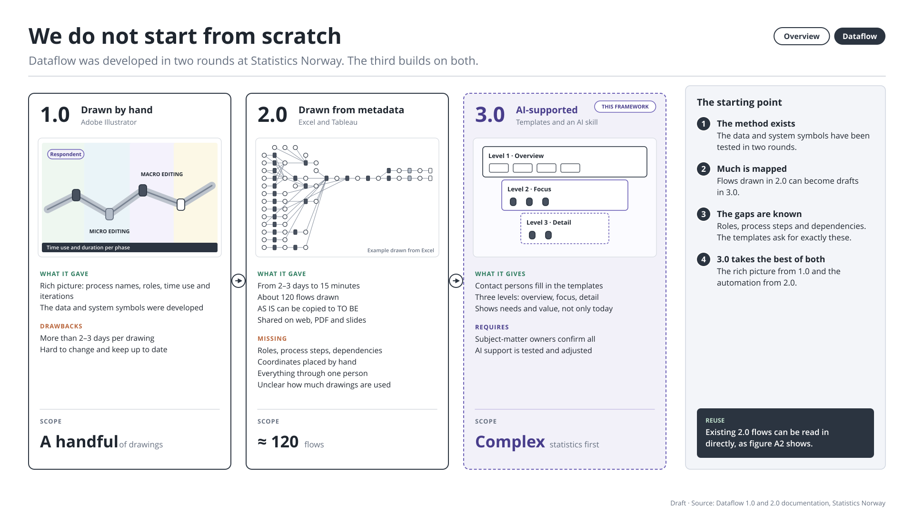
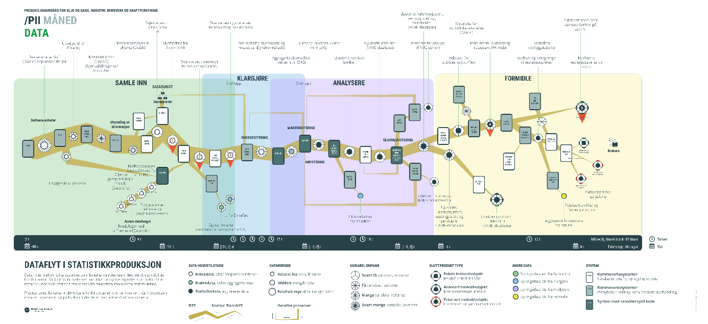
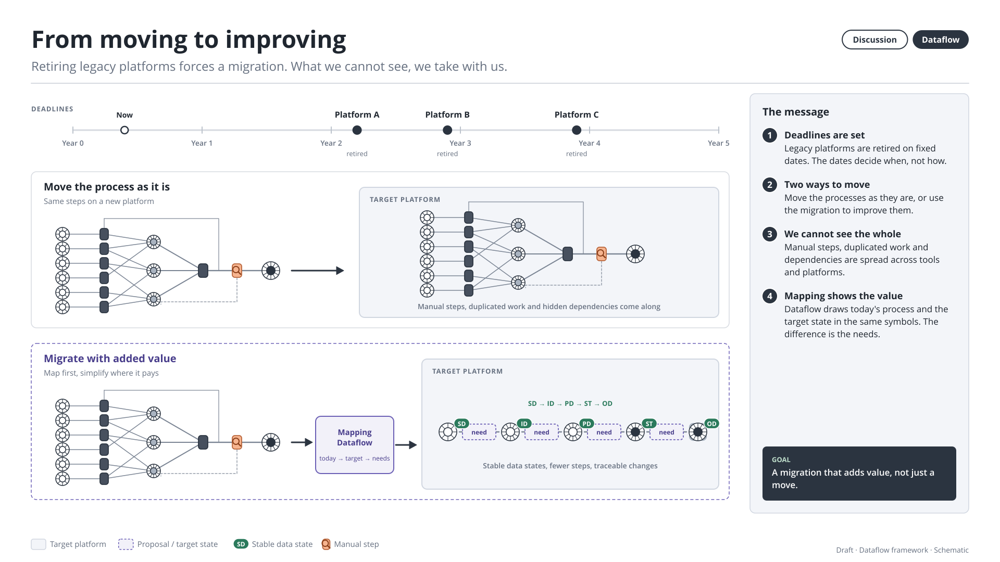
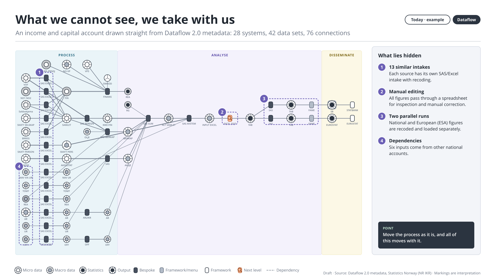

# 1 What is Dataflow?

A statistic is made through a long chain of steps. Data are collected, linked, checked, edited, aggregated, reconciled and published. Each step happens in a system, and each system passes a data set on to the next. Few people can see the whole chain. Most know their own part well.

Dataflow draws the whole chain on one sheet. The aim is to show which IT systems and programs are at work when a statistic is produced, and how the data move through them from collection to dissemination.

## What a dataflow shows

A dataflow has two main symbols:

- **System:** a program, an application, a function, an operation or a tool that does something to the data.
- **Data:** a concrete data set, file or table that comes out of one system and goes into the next.

The symbols are placed in order from left to right across four phase bands: collect, process, analyse and disseminate. These are phases 4 to 7 of the [Generic Statistical Business Process Model](https://unece.org/statistics/modernstats/gsbpm) (GSBPM). The lines between the symbols show where the data go. A data symbol also shows what type of data it is, how much data there is, and how many variables the data set has. A system symbol shows how much the producing unit controls the code itself. [Chapter 2](2-symbol-language.md) explains the symbols.

A drawing does not describe each program in detail. It simplifies, so the whole becomes visible.

## Why it is useful

The feedback on the first drawings was that it was particularly useful to identify every part of the process, end to end. A shared drawing gives a shared language. It makes it easier to talk about what must be developed, who depends on whom, and where the risks are.

That understanding is also the basis for the next step: drawing a future process, a target state, from the data that are needed, the states they should be stored in, and the treatments they should go through.

So Dataflow is not documentation for its own sake. It is a working tool for understanding today’s solution well enough to change it.

## Three versions

<figure class="fig" id="figure-a3" markdown="span">
  [{ loading=lazy }](figures/A3.svg)
  <figcaption>Figure A3. We do not start from scratch · <a href="figures/A3.svg" download>Download SVG</a></figcaption>
</figure>

**Dataflow 1.0 (from 2021)** was drawn by hand in Adobe Illustrator. The drawings were rich: they showed process names, roles, time use per phase, iterative loops and types of end product. A handful were made, among them for an index of industrial production, a labour force survey, air emissions, the balance of payments and research personnel. The drawback was time: each drawing took several days, and they were hard to keep up to date.

<figure class="image" markdown="span">
  [{ loading=lazy }](images/dataflow-1-0-pii.png)
  <figcaption>Dataflow 1.0: an index of production, drawn in Illustrator at Statistics Norway. Labels are in Norwegian.</figcaption>
</figure>

**Dataflow 2.0 (from 2023)** is drawn automatically from metadata. The statistics producer fills in an Excel template, one row per system or data set, and Tableau draws the flow. That cut the drawing time from two or three days to about 15 minutes, and about 120 flows have been drawn this way. The reason was practical: some 30 statistics were to move to a new platform at short notice, and drawing each current process by hand took too long.

The price was that some of what 1.0 showed was lost. Roles, process steps and dependencies on other statistics have no fields in the Excel template. Placing everything in a strict left-to-right order is also demanding, and much of the work has gone through one person.

**Dataflow 3.0 (from 2026)** takes the best of both. The symbols and codes from 2.0 are kept, so existing flows can still be used. The roles, process steps and dependencies from 1.0 return, now as fields in the templates. Mapping is done with templates that a contact person fills in, and the drawings are made with AI support.

## From moving to improving

<figure class="fig" id="figure-a1" markdown="span">
  [{ loading=lazy }](figures/A1.svg)
  <figcaption>Figure A1. From moving to improving · <a href="figures/A1.svg" download>Download SVG</a></figcaption>
</figure>

Many statistical organisations are moving production from legacy platforms to a new one, often a cloud platform. The legacy systems have retirement dates, and those dates force a migration. They do not decide how it is done.

There are two ways to move. One is to move the process as it is, step by step, to the new platform. The other is to use the migration to improve the process: combine similar steps, make manual steps traceable, and store data in agreed states. The first is easier to plan. The second pays more, but it requires that we can see the whole process.

This is where Dataflow 3.0 has its most important job. Without a shared picture of today’s process, we cannot see what can be simplified, and then we take today’s complexity with us.

<figure class="fig" id="figure-a2" markdown="span">
  [{ loading=lazy }](figures/A2.svg)
  <figcaption>Figure A2. What we cannot see, we take with us · <a href="figures/A2.svg" download>Download SVG</a></figcaption>
</figure>

Figure A2 shows the income and capital accounts in Statistics Norway’s national accounts (NR IKR), drawn straight from the Dataflow 2.0 Excel file. The figure shows 28 systems, 42 data sets and 76 connections. The violet markers point to four things that are easy to overlook but matter when the process is redesigned. [Chapter 6](6-example-statistics-norway.md) walks through the example.

## What is new in 3.0

| | Dataflow 2.0 | Dataflow 3.0 |
|---|---|---|
| **Purpose** | Draw today’s process | Draw today’s process and point to needs and value in the target state |
| **Collection** | Excel template, filled in by the producing unit | Templates D1–D3 on the web, and a workshop |
| **Drawing** | Tableau, from coordinates in Excel | AI support with the dataflow skill, or Tableau |
| **Levels** | One: every system and data set | Three: overview, focus and detail |
| **Roles and process steps** | Not included | Own fields |
| **Dependencies** | Drawn as ordinary sources | Own link type and own fields |
| **Data state** | Data type (micro, macro, statistics, output) | Data type and stable data state (source, input, processed, statistics, output) |
| **Target state** | Copy of AS IS, adjusted by hand | Own skeleton with needs, not solutions |
| **Quality assurance** | Review with the producing unit | Source tag on everything, a list of what must be confirmed, two gates |

## What Dataflow is not

Dataflow is not a complete architecture map. It does not show servers, networks or access rights. It does not cover all of GSBPM either, only the four phases from collect to disseminate. And it is not exact: a drawing is a simplified picture that the subject-matter owners have accepted as correct enough for its purpose.

That is a strength. A drawing that tries to show everything becomes unreadable. A drawing that shows what matters for the next decision gets used.
