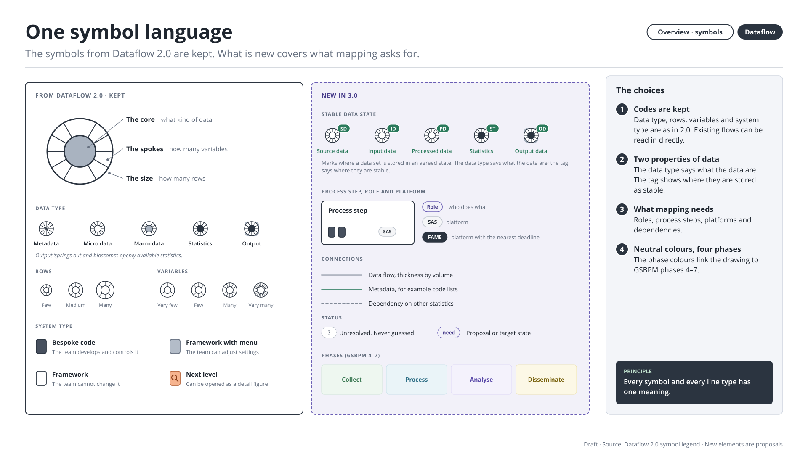

# 2 The symbol language

Dataflow has its own symbol language. It was developed in 1.0, is used in every drawing from 2.0, and is kept in 3.0. Each symbol and each line has one meaning, and the meaning is given in the legend.

<figure class="fig" id="figure-b2" markdown="span">
  [{ loading=lazy }](figures/B2.svg)
  <figcaption>Figure B2. One symbol language · <a href="figures/B2.svg" download>Download SVG</a></figcaption>
</figure>

## Data

A data symbol is a circle that says three things about the data set: what kind of data it is, how much data there is, and how many variables it has.

<a href="symbols/meta-08-2.svg" title="meta-08-2">meta</a>
<a href="symbols/micro-data-08-2.svg" title="micro-data-08-2">micro</a>
<a href="symbols/macro-data-08-2.svg" title="macro-data-08-2">macro</a>
<a href="symbols/stat-data-08-2.svg" title="stat-data-08-2">stat</a>
<a href="symbols/stat-product-simple-08-2.svg" title="stat-product-simple-08-2">out</a>

**The core** shows the data type:

| Code | Data type | Core | Meaning |
|---|---|---|---|
| `meta` | Metadata | No core, spokes only | Code lists, catalogues and other descriptions of data |
| `micro` | Micro data | White | Information about individual units: persons, enterprises, transactions |
| `macro` | Macro data | Light grey | Partly aggregated data |
| `stat` | Statistics | Dark | Fully aggregated statistics, not yet published |
| `out` | Output data | Dark with petals | Disseminated statistics that are openly available |
| `qual` | Quality indicator | – | Defined in the template, but has no symbol of its own and is hardly ever used |

Output data have four petals around the circle. The image is that the data burst into bloom when they reach the users. The petals are only used for what is openly available. A delivery that is not open, for example to an international organisation, is drawn as statistics.

**The size** shows how much data there is, in three sizes: 1 relatively little, 2 medium and 3 relatively much.

**The spokes** show how many variables the data set has, typically the number of columns: 1 very few (3 spokes), 2 few (8 spokes), 3 many (12 spokes) and 4 very many (20 spokes).

### End products

Output data can be drawn with four variants of the petals. They come from the 1.0 legend, where they were called content objects:

| Variant | Petals | Used for |
|---|---|---|
| Simple end product | Dark | Relatively simple content, for example a table in the statistics database |
| Advanced end product | Light grey | More complex content |
| Priority end product | Red and orange | Highlighted and complex content |
| Micro data as a product | Dark, around a white core | Micro data delivered outside, for example to researchers |

### Control data

Small filled circles in the phase colours show control data and other data that arise along the way: reports, logs and check results from collect (green), process (blue), analyse (violet) and disseminate (yellow). They were drawn in 1.0, but have no field in the 2.0 Excel template.

## Systems

A system symbol is a rounded rectangle. Its colour shows who controls the code.

<a href="symbols/system-advanced.svg" title="system-advanced">0 advanced</a>
<a href="symbols/system-bespoke.svg" title="system-bespoke">1 bespoke</a>
<a href="symbols/system-framework-menu.svg" title="system-framework-menu">2 framework, menu</a>
<a href="symbols/system-framework.svg" title="system-framework">3 framework</a>

| Code | System type | Symbol | Meaning |
|---|---|---|---|
| `1` | System with bespoke code | Dark | The producing unit wrote the code itself and can change it |
| `2` | Framework system with menu | Grey | Developed by others, but the unit can adapt some of it through menus |
| `3` | Framework system | White | Developed by other units. The producing unit cannot change anything itself |
| `0` | Advanced solutions | Orange with magnifier | A collection of solutions that needs a drawing of its own. Can be opened as a detail drawing |

## Lines

**Data flow** is a solid line from one symbol to the next. Its thickness follows the amount of data in the data set the line starts from. In 2.0 the line is ochre, as it was in 1.0. In this edition it is a muted blue-grey.

A flow can go from one to one, several can join into one (a *merge*), and one can split into several (a *split*). In 1.0 iterative processes were shown as loops back. That is not supported in 2.0.

Version 3.0 adds two line types:

- **Metadata:** a thin green line, for example from a code list to the system that uses it.
- **Dependency:** a dashed grey line, to and from other statistics, registers and external parties.

## Phase bands

The phase bands are faint backgrounds that show the four main phases. They follow GSBPM:

| Phase | GSBPM | Colour | Code |
|---|---|---|---|
| Collect | 4 | Light green | `collect` |
| Process | 5 | Light blue | `process` |
| Analyse | 6 | Light violet | `analyse` |
| Disseminate | 7 | Light yellow | `disseminate` |

The earlier GSBPM phases (specify needs, design, build) and the last one (evaluate) are not drawn. A dataflow is about the production run.

In 2.0 the bands were drawn by hand in Tableau, and the phase was set on each symbol. That proved hard, because everything had to sit in a strict left-to-right order. In 3.0 the phase is set on the process step, and the bands may overlap where the process actually does.

## New in 3.0

| Element | How it is drawn | What it shows |
|---|---|---|
| **Stable data state** | Green pill with SD, ID, PD, ST or OD on the data symbol | Where the data set is stored in an agreed state: source data, input data, processed data, statistics or output data |
| **Process step** | White box with a dark border | A group of systems and data sets that together do one thing, at level 1 |
| **Platform** | Grey pill, for example SAS or FAME | Which legacy system or tool the step runs on. Can be coloured by deadline |
| **Role** | Violet pill | Who carries out the step. Dashed “Role: ?” when it has not been mapped |
| **Externals** | Grey dashed box outside the phase bands | Other statistics, registers and suppliers |
| **Unresolved** | Dashed grey, with “?” | What has not been assessed. It is never guessed |
| **Proposals and needs** | Dashed violet | Target state and proposals that have not been decided |

**Data type and data state are two different things.** The data type says what the data are: micro data, macro data or statistics. The data state says where they are stored in an agreed state. Many micro data sets can arise during a process, while only one of them is stored as input data. That is why 3.0 keeps the data type as the symbol and adds the state as a tag.

The five stable data states are Statistics Norway’s choice, made for its cloud platform. Another organisation may have different states, or none yet. See [chapter 8](8-adapting.md#data-states).

## Colours

The concept figures use a neutral palette: dark slate for systems and text, light grey for macro data, and the four phase colours. Violet means roles and proposals. Green means data states and metadata. Grey means unresolved or outside. The palette is defined in the [figure code](https://github.com/thomasbjornskau/dataflow-framework/tree/main/figures-src) and in `docs/assets/site.css`, so it can be replaced with an organisation’s own colours.

Every symbol can be downloaded as SVG from the page with [graphic elements](graphic-elements.md).
