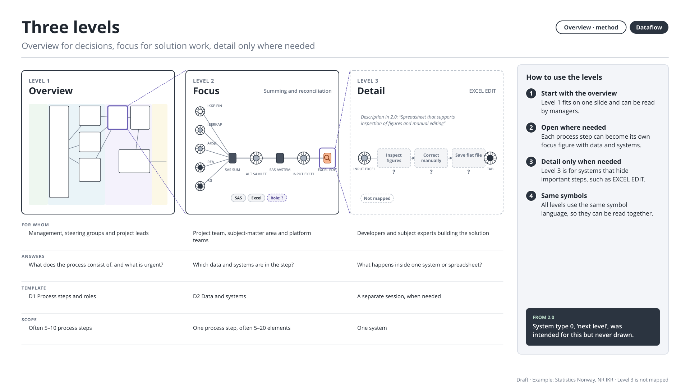
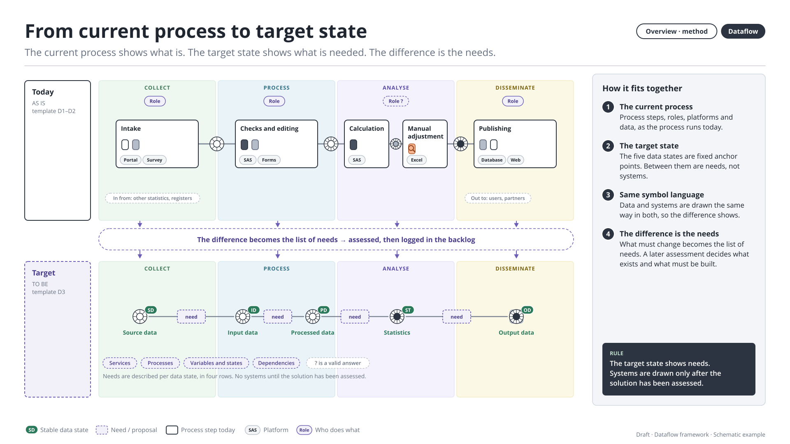
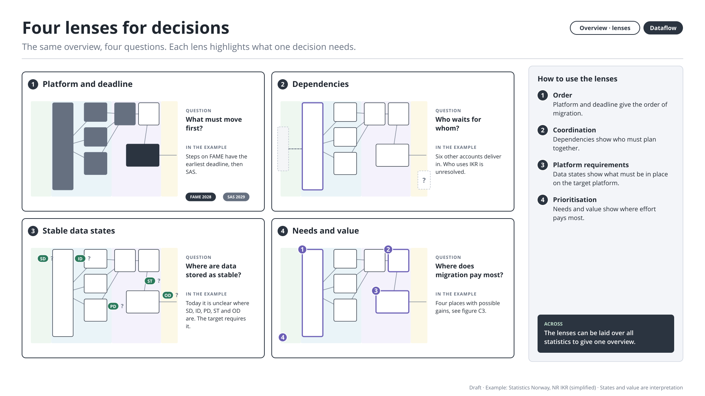

# 3 The drawings

A drawing should answer one question for one audience. That is why Dataflow 3.0 makes several drawings of the same process, at different levels and with different lenses, rather than one large drawing that tries to do everything.

## Three levels

<figure class="fig" id="figure-b1" markdown="span">
  [{ loading=lazy }](figures/B1.svg)
  <figcaption>Figure B1. Three levels · <a href="figures/B1.svg" download>Download SVG</a></figcaption>
</figure>

**Level 1 Overview** shows the whole process as 5–10 process steps across the phase bands, with platforms, roles, dependencies in and out, and the main data sets between the steps. It should fit on one slide and be readable by managers. The question is: what does the process consist of, and what is urgent?

**Level 2 Focus** opens one process step and shows every system and data set in it, with names. This is the level that Dataflow 2.0 drew for the whole process at once. The question is: which data and systems are part of the step?

**Level 3 Detail** opens one system, typically a type 0 system, and shows what happens inside it. It is only used when a system hides important steps, for example a spreadsheet where figures are corrected by hand. What has not been mapped is drawn dashed grey with “?”.

All levels use the same symbols, so they can be read together. In 2.0, system type 0 was meant as a way into a next level, but that level was never drawn. In 3.0 it is part of the method.

## From current process to target state

<figure class="fig" id="figure-b3" markdown="span">
  [{ loading=lazy }](figures/B3.svg)
  <figcaption>Figure B3. From current process to target state · <a href="figures/B3.svg" download>Download SVG</a></figcaption>
</figure>

A mapping has two halves. The first describes today’s process (AS IS): who does what, in which systems, from collection to dissemination. Templates D1 and D2 collect it. The second describes the target state (TO BE): what must be in place to produce the statistic on the target platform. Template D3 collects it.

The target state is organised by data state. In Statistics Norway’s version these are source data, input data, processed data, statistics and output data. For each state, the needs are described in four rows: services, processes, variables and states, and dependencies. The template asks for needs, not solutions. Whether something already exists on the target platform, or must be built, is assessed afterwards.

That gives an important rule for the target state in Dataflow: **the target state shows needs, not systems.** The data states are fixed anchor points, and between them the needs are drawn as dashed violet boxes. System symbols are only drawn once it has been decided what will be used. The difference between today’s process and the target state is the list of needs. It goes on to assessment and into the organisation’s backlog.

## Four lenses

<figure class="fig" id="figure-b4" markdown="span">
  [{ loading=lazy }](figures/B4.svg)
  <figcaption>Figure B4. Four lenses for decisions · <a href="figures/B4.svg" download>Download SVG</a></figcaption>
</figure>

A lens is the same overview, coloured to answer one question:

| Lens | The question | What it highlights |
|---|---|---|
| **Platform and deadline** | What must move first? | Platform pills coloured by the retirement date of each legacy system, earliest darkest |
| **Dependencies** | Who waits for whom? | What the process takes from other statistics, and who uses what comes out |
| **Stable data states** | Where are the data stored as stable? | Where SD, ID, PD, ST and OD are today, or that it is unclear |
| **Needs and value** | Where does the migration pay most? | Numbered markers where there are possible gains |

The lenses can be laid over every statistic in a mapping. Together they give one overview across statistics: which platforms carry the most processes, which statistics are connected, and where the same needs recur.

The deadline lens assumes there is a deadline. If there is none, it becomes a platform lens: which platforms does the process run on, and which of them are to be retired?

## Rules for the drawings

- **One figure, one question, one primary audience.**
- **Status is shown, and never guessed:** exists, in progress, proposal or unresolved. What has not been assessed is shown with “?”.
- **Use the established names** of systems and data sets. Do not give new names to things that exist. The same name may appear more than once in a process, because the same system may do different things in different places.
- **The flow runs from left to right.** The order comes from the connections, not from coordinates.
- **Externals stand outside the phase bands:** what the process takes in on the left, and what it delivers on the right.
- **Many similar steps are combined.** Thirteen near-identical intakes become one process step with thirteen small system symbols, not thirteen boxes.
- **Target states are marked PROPOSAL** or Scenario. What is interpreted and not confirmed is noted in the footer and in the quality checklist.
- **The subject-matter owners approve.** A drawing is not finished until whoever owns the process has said it is correct enough.
