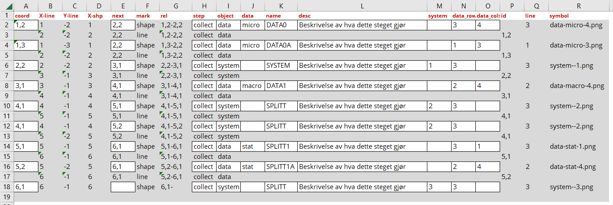

# 4 The data model

A dataflow is data before it is a drawing. In 2.0 the data are an Excel table that Tableau draws from. In 3.0 they are one model per statistic, which the templates fill in and the drawings are made from. This chapter describes both, and how a 2.0 drawing is translated into 3.0.

## The Excel template in 2.0

In the Excel template the statistics producer enters one element per row: a system or a data set. The template turns the order into coordinates and adds what Tableau needs to draw. Fields with a grey background are calculated by formulas and must not be changed.

<figure class="image" markdown="span">
  [{ loading=lazy }](images/dataflow-2-0-excel-template.png)
  <figcaption>The table behind an example in the Excel template. Each element has two rows: one for the symbol and one for the line onwards.</figcaption>
</figure>

### The fields you fill in

**Order | `coord`.** Gives the order from left to right and the vertical position. Write it as two whole numbers separated by a comma, in a cell formatted as text: `1,1` is at the top left, `2,2` is one step to the right and one step down. The comma is a separator, not a decimal sign, so it works whatever the regional settings of Excel are.

**Where does the flow go next? | `next`.** The same notation as `coord`, for the element this one connects to. In a purely sequential flow it moves to the right, one to one. Several elements can go to the same element (merge), and one element can split into several (split). For a split, the row must be duplicated once for each element it goes on to. An element that is the last link has `next` equal to its own `coord`.

**Step in the business process | `step`.** `collect`, `process`, `analyse` or `disseminate`. Elements that follow each other directly should preferably be in the same step.

**System or data set? | `object`.** `system` or `data`.

**If data, what type? | `data`.** `meta`, `micro`, `macro`, `stat`, `out` or `qual`. See [chapter 2](2-symbol-language.md#data).

**Name | `name`.** The name the system or data file is usually known by. Short, preferably. Details belong in the description.

**Description | `desc`.** A short, precise description of what the element is and what happens in the step. The text is shown when the mouse pointer rests on the symbol, and some key descriptions can be shown in the drawing.

**System type | `system`.** `0` advanced solutions, `1` bespoke code, `2` framework system with menu, `3` framework system.

**How much data? | `data_rows`.** `1` relatively little, `2` medium, `3` relatively much. For systems, set `3`.

**How many variables? | `data_cols`.** `1` very few, `2` few, `3` many, `4` very many.

### The calculated fields

| Field | What the formula does |
|---|---|
| `X-line`, `Y-line` | First and second number in `coord` (for the symbol row) and in `next` (for the line). `Y-line` is multiplied by −1, so the drawing is sorted from top to bottom |
| `X-shp` | Copy of `X-line`. Used as a separate axis for the symbols |
| `mark` | `shape` on the first row, `line` on the second |
| `rel` | A relation between `coord` and `next`, which Tableau uses to draw the line |
| `id` | Copy of `coord` on the line row |
| `line` | Copy of `data_rows`. Sets the thickness of the line |
| `symbol` | The file name of the symbol, for example `data-micro-4.png` or `system--1.png` |

Each element has two rows. The first draws the symbol, the second the line onwards. The template makes the second row from the first.

### Weaknesses of the 2.0 model

Experience with about 120 flows shows some weaknesses. They are why the model has changed in 3.0:

- **The coordinate is both position and identity.** Move an element, and every connection to it must change.
- **An element with several outputs has several rows,** with all the information repeated. That easily leads to contradictions.
- **`step` does not control the phase bands.** They were drawn by hand, and elements can end up in a different band from the one `step` says.
- **There is only one type of line.** Metadata and dependencies on other statistics are drawn as ordinary data flow.
- **Roles, process steps, platform and data state have no fields.**

## The model in 3.0

In 3.0 each statistic is described by one model. The templates D1–D3 fill it in, an existing 2.0 file can be read into it, and every drawing is made from it. The model is written as YAML, so both people and AI can read and change it.

```yaml
statistic: {short: NR IKR, name: Income and capital accounts, group: false}
version: {date: 2026-10-08, status: draft, sources: ["Dataflow 2.0", "D1"]}

steps:
  - id: P5
    name: Summing and reconciliation
    phase: analyse             # collect | process | analyse | disseminate
    what: Sums all sources and reconciles
    role: "?"                  # a role, not a name
    platforms: [SAS]
    applies_to: all            # all | some (for groups)
    source: interpretation

objects:
  - id: S1
    name: SAS SUM
    object: system
    system_type: 1             # 0, 1, 2 or 3
    platform: SAS
    step: P5
    description: SAS application that sums all sources
    status: exists             # exists | in progress | proposal | "?"
    source: "2.0"
    ref_2_0: "7,5"             # the coordinate in 2.0, for traceability
  - id: D1
    name: ALT SAMLET
    object: data
    data_type: macro           # meta | micro | macro | stat | out | qual
    rows: 2                    # 1, 2 or 3
    variables: 3               # 1, 2, 3 or 4
    stable_state: "?"          # SD | ID | PD | ST | OD | none | "?"
    step: P5

links:
  - {from: S1, to: D1, type: data flow}   # data flow | metadata | dependency

externals:
  - {id: X_REA, name: REA, direction: in, type: statistic}

needs:                         # target state only
  - id: N1
    state: ID
    type: service              # service | process | variables | dependency
    need: Shared intake and recoding of sources
    replaces: [P1]
    value: One tested routine, less maintenance
    risk: 13 SAS routines must move before the SAS deadline
    on_target_platform: "?"    # yes | no | "?"
    source: interpretation
```

The rules of the model:

- **The ID is independent of position.** Coordinates may be kept as optional hints, but the order is derived from the connections.
- **Everything has a source tag:** D1, D2, D3, 2.0, workshop or interpretation. That lets the quality checklist be made automatically.
- **“?” is a value.** It stays until someone has actually answered.
- **Data type and stable state are two fields.** See [chapter 2](2-symbol-language.md#new-in-30).

Names of systems and data sets stay in the language they are used in. In the example, `ALT SAMLET` (“all combined”) and `SAS AVSTEM` (“SAS reconcile”) are Norwegian names, and they are not translated.

## From 2.0 to 3.0

A 2.0 flow can be read into the model without filling anything in again. Most of it translates directly. The rest becomes “?” or an interpretation that must be confirmed.

| 2.0 | 3.0 | Note |
|---|---|---|
| `coord` | new `id`, and `ref_2_0` | Duplicates with the same coordinate are merged into one object |
| `next` | `links` | `next` equal to `coord` means an end node |
| `object` | `object` | |
| `data` | `data_type` | |
| `system` | `system_type` | |
| `data_rows`, `data_cols` | `rows`, `variables` | For systems, `data_rows` is ignored |
| `step` | `phase` on the process step | Checked against the position in the drawing |
| `name`, `desc` | `name`, `description` | The names are kept |
| – | `platform` | Derived from the name when it is clear (SAS, FAME, Excel). Tagged as interpretation |
| – | process steps | Proposed by grouping objects. Always an interpretation until confirmed |
| – | role, dependencies out, stable state, needs | Set to “?” |

Elements on the far left that are really other statistics, for example accounts that a national accounts process takes figures from, are moved to `externals` and connected with dependency lines.
