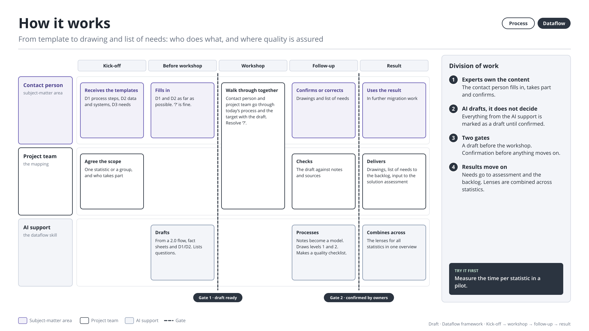
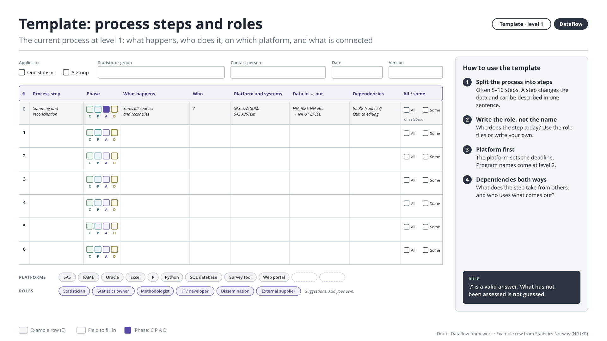
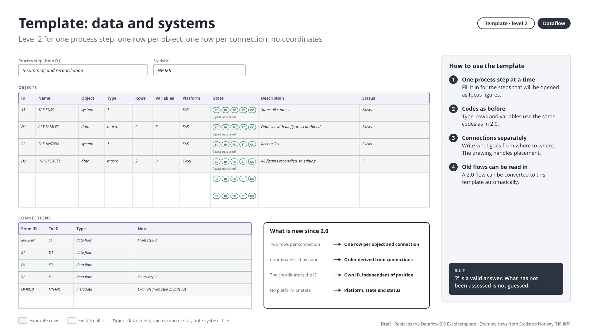
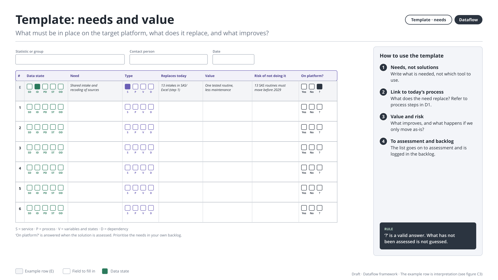

# 5 How to map

Mapping is the most important work. A drawing can be made quickly once the content is in place. Finding every system and data set in the process, describing them and putting them in the right order takes time, and only the people who know the process can do it.

This chapter describes the mapping process in Dataflow 3.0: a kick-off meeting, a workshop, follow-up and the result. It was designed for mapping complex statistics before a platform migration, but it works for any mapping where the people who run the process have limited time.

## The process

<figure class="fig" id="figure-d4" markdown="span">
  [{ loading=lazy }](figures/D4.svg)
  <figcaption>Figure D4. How it works · <a href="figures/D4.svg" download>Download SVG</a></figcaption>
</figure>

| Phase | Contact person (subject-matter area) | Mapping team | AI support |
|---|---|---|---|
| **Kick-off** | Receives templates D1–D3 | Agrees the scope: one statistic or a group, and who takes part | |
| **Before the workshop** | Fills in D1 and D2 as far as possible. “?” is fine | | Drafts from an existing 2.0 flow, fact sheets and D1/D2, and lists questions |
| **Gate 1: draft ready** | | | |
| **Workshop** | Goes through the process with the mapping team, using the draft | Leads the walk-through and resolves “?” | |
| **Follow-up** | Confirms or corrects the drawings and the list of needs | Checks the draft against notes and sources | Turns the notes into a model, draws levels 1 and 2, makes a quality checklist |
| **Gate 2: confirmed by the owners** | | | |
| **Result** | Uses the result in further migration work | Delivers drawings, the list of needs to the backlog, and input to the solution assessment | Combines the lenses for all statistics into one overview |

Three things make the process robust:

- **The experts own the content.** The contact person fills in, takes part and confirms. No drawing goes further until it has been confirmed.
- **AI drafts, it does not decide.** Everything the AI support produces is marked as a draft, with a source tag on each element, until it has been confirmed.
- **Two gates.** There must be a draft before the workshop, so the time is spent correcting rather than starting from nothing. And the subject-matter owners confirm before anything goes further.

The workshop can be run without AI support. The mapping team then makes the draft and the drawings by hand, or with Excel and Tableau. The gates stay the same.

## Before the workshop

### Start with what exists

If the statistic already has a Dataflow 2.0 drawing, it is a good starting point. The Excel file can be read in directly and give a draft of both level 1 and level 2. Fact sheets, existing documentation and the notes from the kick-off also provide a lot.

### Fill in D1 and D2

<figure class="fig" id="figure-d1" markdown="span">
  [{ loading=lazy }](figures/D1.svg)
  <figcaption>Figure D1. Template: process steps and roles · <a href="figures/D1.svg" download>Download SVG</a></figcaption>
</figure>

**[Template D1 Process steps and roles](template/d1.md)** describes the process at level 1. Split the process into steps from collection to dissemination, often 5–10. A step is something that changes the data and can be described in one sentence. For each step, write the phase, what happens, who does it, which platform it runs on, which data go in and out, and the dependencies. Write the role, not the name. Platform first; program names come in D2.

<figure class="fig" id="figure-d2" markdown="span">
  [{ loading=lazy }](figures/D2.svg)
  <figcaption>Figure D2. Template: data and systems · <a href="figures/D2.svg" download>Download SVG</a></figcaption>
</figure>

**[Template D2 Data and systems](template/d2.md)** describes level 2: every data set and system, one process step at a time, and the connections between them. It uses the same codes as the 2.0 Excel template, but without coordinates. Each object gets an ID, and the connections are written with the IDs. The drawing takes care of placement.

There is no need to fill in D2 for the whole process. Start with the steps that are most complex, or where there is most uncertainty.

### On paper, if you prefer

Many people get the most out of starting on paper. Print the A3 grid, draw the systems and data sets in pencil, and discuss the order around the table. The grid has coordinates 1–10, 11–20 and 21–30, so positions can be transferred to the 2.0 Excel template. See [chapter 7](7-tools.md#a3-grids-for-workshops).

## At the workshop

The workshop goes through today’s process, with the draft as a basis. The aim is not a perfect drawing, but to resolve what is uncertain and bring out what is missing:

- **Who does what?** Roles are rarely found in existing documentation.
- **What is done by hand?** Spreadsheets, manual corrections and checks that are not automated are easy to overlook, and that is often where the risk lies.
- **Who do you depend on,** and who depends on you?
- **Where are the data stored as stable today?** And where should they be stored on the target platform?

After going through today’s process, the workshop turns to the target state: what must be in place to produce the statistic on the target platform?

## After the workshop

### Fill in D3

<figure class="fig" id="figure-d3" markdown="span">
  [{ loading=lazy }](figures/D3.svg)
  <figcaption>Figure D3. Template: needs and value · <a href="figures/D3.svg" download>Download SVG</a></figcaption>
</figure>

**[Template D3 Needs and value](template/d3.md)** collects the needs for the target state, one per row. For each need, state which data state it belongs to, what kind of need it is (service, process, variables and states, or dependency), what it replaces in today’s process, what value it gives, and what the risk is of not doing it. Write needs, not solutions. Whether something exists on the target platform is assessed later.

The columns for value and risk are what separate Dataflow 3.0 from a plain inventory. They make it possible to see where the migration pays most, and what it costs to only move.

### Make text for the AI assistant

When the templates are filled in, select **Make combined text for the AI assistant** on the [templates overview](template/index.md#your-answers). The text collects everything you have written and asks for a model, drawings and a quality checklist. Paste it into a conversation with your AI assistant. Attach the 2.0 Excel file if there is one.

### Quality assurance

What the AI support delivers is a draft with a quality checklist. The list is divided by who must confirm: the subject-matter owners, the project lead or whoever drew it. Typical points:

- the division into process steps, which is nearly always an interpretation
- platforms derived from program names
- data sets with no known source
- value and gains that have been proposed but not assessed by the subject-matter owners

Only when the list has been worked through and the owners have confirmed are the drawings finished.

## Good advice

- **One question at a time.** A mapping that asks twenty questions at once gets half answers.
- **“?” is a valid answer.** What has not been assessed should not be guessed. An empty field is better than a wrong one.
- **Use the names you use.** Write the name as it appears in the code or the folder, and explain in the description instead.
- **Start with one statistic.** The templates can be used for a group of statistics, with “all” or “some” on each row, but they are easiest to fill in for one.
- **Draw the boundary when there is one.** If the process has a legal or organisational boundary, for example between two units or an external supplier, the drawing should show it, not smooth it over.
