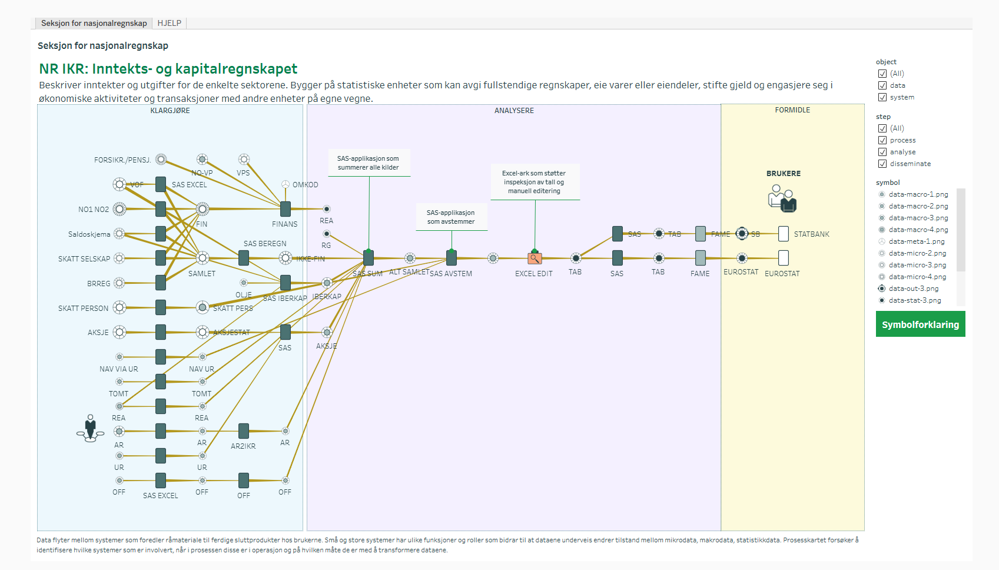
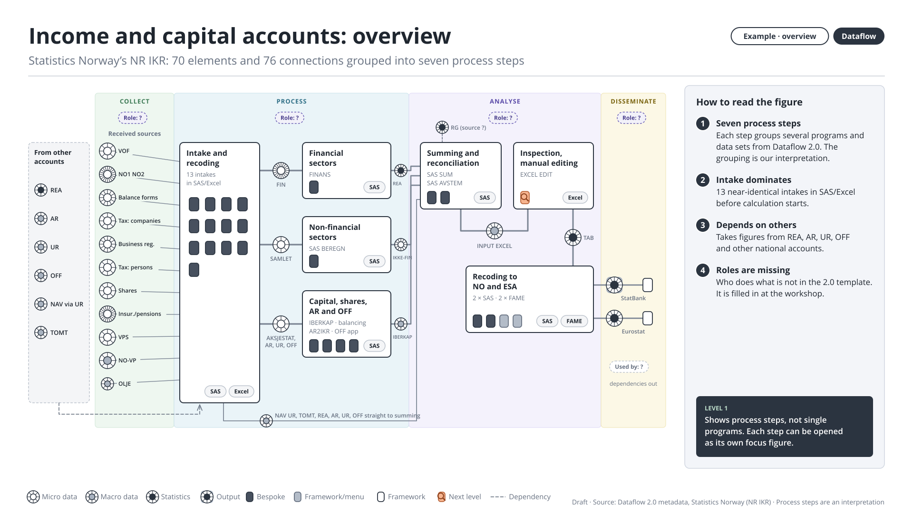
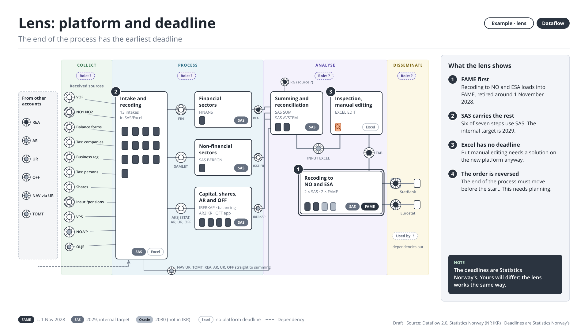
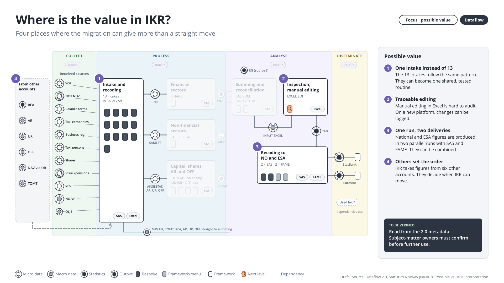
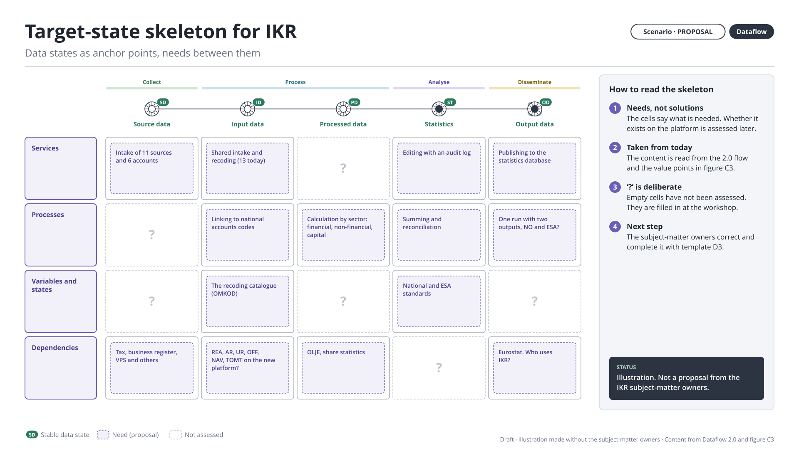
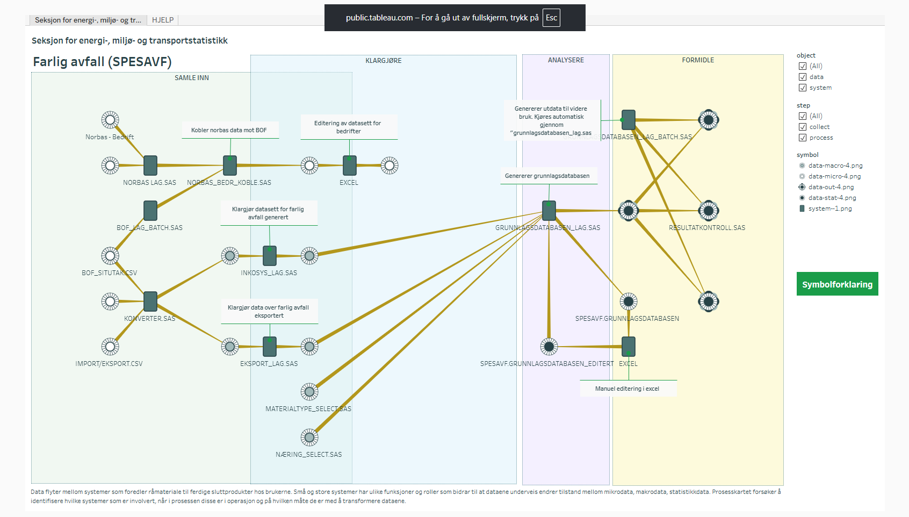

# 6 Worked example: income and capital accounts at Statistics Norway

The income and capital accounts in Statistics Norway’s national accounts (NR IKR) describe income and expenditure for each sector of the economy. The process was drawn in Dataflow 2.0 and was used as the first example of Dataflow 3.0. It is a good example because it is complex: many sources, many parallel steps, dependencies on other accounts, and manual editing.

!!! warning "Interpretation, not the answer"
    The example was made from the Dataflow 2.0 Excel file, without a review with the subject-matter owners. The division into process steps and the proposed gains are interpretations that must be confirmed by the people who own the process.

## The context

Statistics Norway is moving its statistical production from legacy platforms to a cloud data platform. At the time of the mapping in autumn 2026, the retirement dates were about 1 November 2028 for FAME, 2029 for SAS (an internal target) and 2030 for Oracle. Complex statistics were mapped first, with workshops per statistic or group of statistics.

The names of systems and data sets in the figures are kept in Norwegian, as they appear in the code. NO and ESA are the national and the European (ESA 2010) versions of the accounts. REA, AR, UR and OFF are other parts of the national accounts that IKR takes figures from.

## The starting point: the 2.0 drawing

<figure class="image" markdown="span">
  [{ loading=lazy }](images/tableau-nr-ikr.png)
  <figcaption>NR IKR in Dataflow 2.0, drawn in Tableau from the Excel template. Labels are in Norwegian.</figcaption>
</figure>

The drawing has 70 elements (28 systems and 42 data sets) and 76 connections. It shows every program and every data set, but the structure is hard to see. It is also hard to see what matters for the migration. The roles are not in the drawing, and the dependencies on other accounts are drawn as ordinary sources.

Figure A2 in [chapter 1](1-what-is-dataflow.md#figure-a2) shows the same flow redrawn from the Excel file with the 3.0 symbols.

## Level 1: the overview

<figure class="fig" id="figure-c1" markdown="span">
  [{ loading=lazy }](figures/C1.svg)
  <figcaption>Figure C1. Income and capital accounts: overview · <a href="figures/C1.svg" download>Download SVG</a></figcaption>
</figure>

The 70 elements are grouped into seven process steps:

1. **Intake and recoding** (process). Thirteen near-identical intakes in SAS and Excel, from eleven sources and six other accounts.
2. **Financial sectors** (process). FINANS, with the recoding catalogue as metadata.
3. **Non-financial sectors** (process). SAS BEREGN.
4. **Capital, shares, AR and OFF** (process). Four SAS programs.
5. **Summing and reconciliation** (analyse). SAS SUM and SAS AVSTEM. RG also comes in here, with no known source.
6. **Inspection and manual editing** (analyse). EXCEL EDIT, a spreadsheet where figures are inspected and corrected by hand.
7. **Recoding to NO and ESA** (analyse). Two SAS programs and two FAME databases, on to the statistics database and Eurostat.

The roles have not been mapped and are shown as “Role: ?”. Who uses IKR is not known either. Both are questions for the workshop.

## Lens: platform and deadline

<figure class="fig" id="figure-c2" markdown="span">
  [{ loading=lazy }](figures/C2.svg)
  <figcaption>Figure C2. Lens: platform and deadline · <a href="figures/C2.svg" download>Download SVG</a></figcaption>
</figure>

The lens colours the platform pills by the retirement date of each legacy system. Six of seven steps use SAS. The last step, recoding to NO and ESA, loads into FAME, which has the earliest deadline. So the end of the process must move before the start, and that must be part of the plan.

## Where is the value?

<figure class="fig" id="figure-c3" markdown="span">
  [{ loading=lazy }](figures/C3.svg)
  <figcaption>Figure C3. Where is the value in IKR? · <a href="figures/C3.svg" download>Download SVG</a></figcaption>
</figure>

Four places where the migration can give more than a straight move:

1. **One intake instead of 13.** The intakes follow the same pattern. On the new platform they can become one shared, tested routine.
2. **Traceable editing.** Manual editing in Excel is hard to audit. On the new platform the changes can be logged.
3. **One run, two deliveries.** The NO and ESA figures are made in two parallel runs. They can be coordinated.
4. **Others set the order.** IKR takes figures from six other accounts. They decide when IKR can move.

The points were read from the 2.0 drawing and are proposals for what the workshop should look at.

## The target-state skeleton

<figure class="fig" id="figure-c4" markdown="span">
  [{ loading=lazy }](figures/C4.svg)
  <figcaption>Figure C4. Target-state skeleton for IKR · <a href="figures/C4.svg" download>Download SVG</a></figcaption>
</figure>

The skeleton shows what the target state can look like for IKR, with the five data states as columns and the needs in the cells. The content is taken from the 2.0 flow and the value points above. The empty cells are deliberate: they have not been assessed and are to be filled in at the workshop, with [template D3](template/d3.md).

## For comparison: a process with all four phases

<figure class="image" markdown="span">
  [{ loading=lazy }](images/tableau-spesavf.png)
  <figcaption>Hazardous waste statistics (SPESAVF) in Dataflow 2.0. The process has all four phases, and collect and process overlap. Labels are in Norwegian.</figcaption>
</figure>

IKR has no collection of its own. All its sources are data already collected by others. Hazardous waste is an example of a process with all four phases. It also shows that the phases overlap in practice, so a strict phase band per element does not always fit. That is why the phase is set on the process step in 3.0.

## What the example shows about the framework

- **The 2.0 metadata were enough for a first draft.** Levels 1 and 2, the deadline lens and the value points were made from one Excel file, without a meeting.
- **What was missing is what matters most for the migration:** roles, who uses the output, and where data are stored as stable. The templates and the workshop are there to fill exactly those gaps.
- **The deadline lens changed the order.** Without it, the natural plan would be to move the process from the start.
