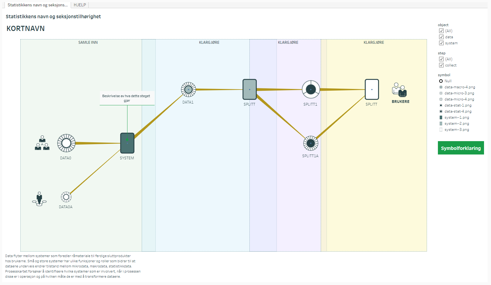

# 7 Tools and downloads

A dataflow can be drawn in three ways: by hand on paper, with Excel and Tableau as in 2.0, or with AI support as in 3.0. They use the same symbols and the same codes, so you can start one way and carry on another.

## Everything to download

| File | What | Used for |
|---|---|---|
| [dataflow_template.xlsx](files/templates/dataflow_template.xlsx) | The Excel template from Dataflow 2.0 | Entering systems and data sets for Tableau to draw |
| [dataflow_template.twbx](files/templates/dataflow_template.twbx) | The Tableau template, with the symbols embedded | Drawing the flow from the Excel file |
| [tableau-symbols.zip](files/tableau-symbols.zip) | The 24 symbols as PNG | Installing the symbols in Tableau |
| [dataflow_example_nr_ikr.xlsx](files/templates/dataflow_example_nr_ikr.xlsx) | Completed Excel template for NR IKR | An example of a complex flow (names in Norwegian) |
| [dataflow_grid_A3_01-10.pdf](files/templates/dataflow_grid_A3_01-10.pdf) · [11–20](files/templates/dataflow_grid_A3_11-20.pdf) · [21–30](files/templates/dataflow_grid_A3_21-30.pdf) | A3 grids | Drawing by hand at a workshop |
| [symbols-svg.zip](files/symbols-svg.zip) | All 121 symbols as SVG | Drawing yourself, in slides, Illustrator or code |
| [dataflow.zip](files/skills/dataflow.zip) · [SKILL.md](files/skills/dataflow/SKILL.md) | The dataflow skill | AI support for mapping and drawing |
| [Templates D1–D3](template/index.md) | Fillable templates on the web | Mapping, and making text for the AI assistant |

## The Excel template

<figure class="image" markdown="span">
  [{ loading=lazy }](images/dataflow-2-0-tableau-template.png)
  <figcaption>The template in Tableau, drawn from a small example in the Excel template. The example shows a split, where one data set goes on to two systems. Screenshot of the Norwegian original.</figcaption>
</figure>

The Excel template has three sheets:

- **`shortname`** is the sheet you fill in. You may rename it after the statistic’s short name.
- **`help`** explains each field, and whether it is to be filled in or is calculated.
- **`lists`** holds the values allowed in each field. The fields in `shortname` have drop-down lists that read from this sheet.

How to fill it in:

1. **Save a copy** named `dataflow_<shortname>.xlsx`.
2. **Fill in one row per system or data set**, in the white fields: `coord`, `next`, `step`, `object`, `data` or `system`, `name`, `desc`, `data_rows` and `data_cols`. The fields are explained in [chapter 4](4-data-model.md#the-fields-you-fill-in).
3. **Copy the formula row.** Each element has two rows. The second row, with `line` in `mark`, is made by formulas. Copy both rows down when you add an element.
4. **For a split, duplicate the row** once for each element the flow goes on to, with a different `next`.
5. **Do not change the grey fields.** They are calculated.

The formulas use the functions `TEXTBEFORE` and `TEXTAFTER`. They exist in recent versions of Excel. In older versions an error is shown in the columns `X-line` and `Y-line`.

Format the `coord` and `next` cells as text before typing, or Excel may turn `1,10` into a number.

## The Tableau template

The Tableau template draws the flow from the Excel file. It has three tabs:

- **SHORTNAME** is the drawing itself. It uses two axes: one with lines (`X-line`, `Y-line`), where the thickness follows `line`, and one with symbols (`X-shp`, `Y-line`), where the shape follows `symbol` and the size `data_rows`. The name is shown as a label, and the description when the mouse pointer rests on a symbol.
- **Statistic name and owner** is the dashboard. It has the phase bands as text boxes, filters for `object` and `step`, the legend and icons for sources and users.
- **HELP** shows the legend.

To make a new drawing:

1. **Open `dataflow_template.twbx`** in Tableau Desktop or Tableau Public.
2. **Replace the data source** with your own Excel file: *Data → Replace Data Source*, and choose the sheet you filled in.
3. **Adjust the axes.** The template has fixed axes (X from 0 to 7, Y from −4 to 0), fitted to the example. Extend them to the coordinates in your flow.
4. **Move the phase bands.** They are text boxes on the dashboard and must be placed by hand, to match `step`.
5. **Write the title and owner** in the title field, and attach any explanatory boxes to the main symbols.
6. **Publish or export.** Tableau Public is open to everyone. Do not publish drawings that show internal matters. Use print, PDF or an image instead.

The symbols are embedded in the workbook. To use them in a new workbook, unzip [tableau-symbols.zip](files/tableau-symbols.zip) into a folder called `Data flow` under *My Tableau Repository → Shapes*, and restart Tableau. Keep the file names as they are, because the `symbol` column in the Excel template refers to them.

!!! note "Translated, not yet tested in Tableau"
    The English Tableau template is a translation of the Norwegian original, with the neutral palette. The labels, the data-source path and the embedded symbols have been changed in the workbook file, but the result has not yet been opened in Tableau. Report anything that does not work.

## A3 grids for workshops

Three grids in A3 portrait, for drawing the flow by hand:

- [Coordinates 1–10](files/templates/dataflow_grid_A3_01-10.pdf)
- [Coordinates 11–20](files/templates/dataflow_grid_A3_11-20.pdf)
- [Coordinates 21–30](files/templates/dataflow_grid_A3_21-30.pdf)

The numbers along the edges are the same as in `coord` in the Excel template. Place the data sets and systems where the lines cross, and read off the coordinates when the drawing is to be transferred. Long processes continue on the next sheet.

It helps to list the systems and data sets before plotting them in the grid. Templates D1 and D2 can be printed and used for that.

## AI support: the dataflow skill { #ai-support }

The **dataflow** skill is a set of instructions that teaches an AI assistant to map and draw dataflows by the method on these pages. It is written as one Markdown file, `SKILL.md`, and contains the symbol language, the data model, the drawing rules and the form factor for the figures. It was written for Claude, which loads skills directly, but it is plain text and can be given to other assistants as instructions.

### What the skill does

The skill has three working modes:

| Mode | You give | You get |
|---|---|---|
| **A Read in** | An Excel file from Dataflow 2.0, and screenshots from Tableau if you have them | A model, a check drawing of the whole flow, proposed process steps (level 1) and a list of questions |
| **B Map with the templates** | Text from templates D1–D3, workshop notes | An updated model, follow-up questions one at a time, new drawings |
| **C Draw** | A model that already exists | Levels 1–3, lenses, the target-state skeleton, blank templates |

Each delivery has a model file (YAML), drawings as SVG in 16:9 and a quality checklist divided by who must confirm.

### How to use it

1. **Download [dataflow.zip](files/skills/dataflow.zip).**
2. **Install it as a skill** in your assistant. In Claude this is done under the settings for skills. For an assistant without skills, paste the content of `SKILL.md` into the project instructions or at the start of the conversation.
3. **Fill in the templates** and select **Make combined text for the AI assistant** on the [overview](template/index.md#your-answers).
4. **Start a new conversation,** paste the text, and attach the 2.0 Excel file if there is one.
5. **Answer the questions** the skill asks, and ask for the drawings you need.

The text from the templates is made for the skill, but it is ordinary text. You can read it, correct it and add to it before pasting it in.

### What to be aware of

- **Follow your organisation’s guidelines for using AI.** The templates are about systems and data sets, not about people or figures. Do not enter personal data, unpublished figures or access information.
- **The result is a draft.** The skill marks what it has interpreted, and the subject-matter owners must confirm before the drawings are used further.
- **The drawings may vary a little** from one time to the next, because the drawing code is written anew in each conversation. The model file is what keeps the result stable. Keep it, and give it to the skill next time. The [figure code](https://github.com/thomasbjornskau/dataflow-framework/tree/main/figures-src) in the repository gives the same figures every time, for those who prefer code.

## Changing the templates on these pages

Templates D1–D3 are built by the script `figures-src/build_templates.py` in the repository. Each field has a fixed key. If the keys are changed after the templates are in use, browsers will no longer find the answers people have written. See [chapter 8](8-adapting.md#templates).
