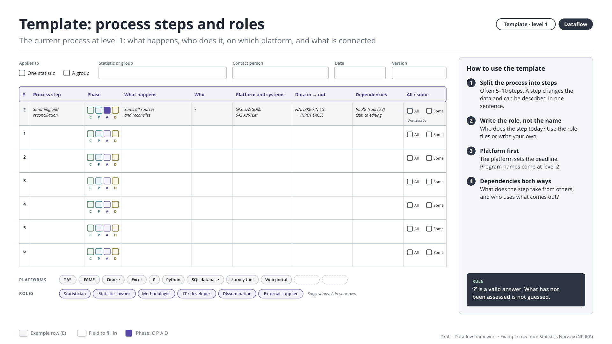

# Template D1: Process steps and roles

The current process at level 1: what happens, who does it, on which platform and what is connected. The template is based on [figure D1](../5-how-to-map.md#figure-d1).

!!! info "How to fill it in"

    1. **Fill in the fields about the statistic.** They are shared by all templates.
    2. **Split the process into steps** from collection to dissemination. Write the role, not the name.
    3. **Platform first.** Program names come in template D2.
    4. **Write ‘?’** where you do not know. It is a valid answer.

    Your answers are stored only in this browser. When you are done, select **Make text for the AI assistant** and paste the text into your assistant. You can also download your answers or make a backup from the [overview](index.md#your-answers).

!!! warning "Do not enter information that must not be shared"
    The templates describe systems, data sets and processes, not people or figures. Do not enter personal data, unpublished figures, passwords or access information. The text you make is meant for an AI tool: follow your organisation's guidelines for using AI.

<button type="button" class="md-button md-button--primary" data-do="ai">Make text for the AI assistant</button><button type="button" class="md-button" data-do="copy">Copy answers</button><button type="button" class="md-button" data-do="download">Download (.md)</button><button type="button" class="md-button" data-do="print">Print</button><button type="button" class="md-button tmpl-clear" data-do="clear">Clear template</button>

Text for the AI assistant. Copy it into a conversation, together with a Dataflow 2.0 Excel file if you have one.
<textarea readonly rows="8" aria-label="Text for the AI assistant"></textarea><button type="button" class="md-button" data-do="copyai">Copy the text</button>
<form class="tmpl-form" onsubmit="return false"><datalist id="platforms"><option value="SAS"><option value="FAME"><option value="Oracle"><option value="Excel"><option value="R"><option value="Python"><option value="SQL database"><option value="Survey tool"><option value="Web portal"><option value="Cloud platform"></datalist><datalist id="roles"><option value="statistician"><option value="statistics owner"><option value="methodologist"><option value="IT / developer"><option value="dissemination"><option value="external supplier"></datalist><section class="tmpl-part tmpl-common"><h3>About the statistic (shared by all templates)</h3>
<label class="tmpl-field">Statistic<input type="text" data-k="common.statistic" data-l="Statistic" placeholder="Example: Income and capital accounts"></label><label class="tmpl-field">Short name<input type="text" data-k="common.short" data-l="Short name" placeholder="Example: NR IKR"></label><label class="tmpl-field">Organisational unit<input type="text" data-k="common.unit" data-l="Organisational unit" placeholder="Example: National accounts division"></label><label class="tmpl-field">Contact person<input type="text" data-k="common.contact" data-l="Contact person" placeholder="Role or name"></label>

<label class="tmpl-field">Does the template cover one statistic or a group?<select data-k="common.scope" data-l="Applies to"><option value=""></option><option value="one">One statistic</option><option value="group">A group of statistics</option></select></label><label class="tmpl-field">Statistics in the group<input type="text" data-k="common.group" data-l="Statistics in the group" placeholder="Groups only: short names or initials"></label><label class="tmpl-field">Date<input type="text" data-k="common.date" data-l="Date" placeholder="Example: 26 Nov 2026"></label>
</section><section class="tmpl-part "><h3>Process steps in order</h3>
A step changes the data and can be described in one sentence. Often 5–10 steps. The first row shows an example from Statistics Norway.

<table class="tmpl-t" data-list="_list.D1"><thead><tr><th>#</th><th>Process step</th><th>Phase</th><th>What happens</th><th>Who (role)</th><th>Platform and systems</th><th>Data in → out</th><th>Dependencies</th><th>All / some</th></tr></thead><tbody><tr><td class="tmpl-nr">1</td><td style="min-width:11em"><input type="text" data-k="D1.step.1.name" data-l="Process step" placeholder="Summing and reconciliation"></td><td style="min-width:8em"><select data-k="D1.step.1.phase" data-l="Phase"><option value=""></option><option value="collect">Collect</option><option value="process">Process</option><option value="analyse">Analyse</option><option value="disseminate">Disseminate</option><option value="several">Several phases</option><option value="?">?</option></select></td><td style="min-width:14em"><textarea data-k="D1.step.1.what" data-l="What happens" rows="1" placeholder="Sums all sources and reconciles"></textarea></td><td style="min-width:9em"><input type="text" data-k="D1.step.1.role" data-l="Who (role)" placeholder="?" list="roles"></td><td style="min-width:11em"><input type="text" data-k="D1.step.1.platform" data-l="Platform and systems" placeholder="SAS" list="platforms"></td><td style="min-width:12em"><textarea data-k="D1.step.1.data" data-l="Data in → out" rows="1" placeholder="FIN, IKKE-FIN → INPUT EXCEL"></textarea></td><td style="min-width:11em"><textarea data-k="D1.step.1.dep" data-l="Dependencies" rows="1" placeholder="In: RG (source ?)"></textarea></td><td style="min-width:6em"><select data-k="D1.step.1.scope" data-l="All / some"><option value=""></option><option value="all">All</option><option value="some">Some</option><option value="?">?</option></select></td></tr><tr><td class="tmpl-nr">2</td><td style="min-width:11em"><input type="text" data-k="D1.step.2.name" data-l="Process step"></td><td style="min-width:8em"><select data-k="D1.step.2.phase" data-l="Phase"><option value=""></option><option value="collect">Collect</option><option value="process">Process</option><option value="analyse">Analyse</option><option value="disseminate">Disseminate</option><option value="several">Several phases</option><option value="?">?</option></select></td><td style="min-width:14em"><textarea data-k="D1.step.2.what" data-l="What happens" rows="1"></textarea></td><td style="min-width:9em"><input type="text" data-k="D1.step.2.role" data-l="Who (role)" list="roles"></td><td style="min-width:11em"><input type="text" data-k="D1.step.2.platform" data-l="Platform and systems" list="platforms"></td><td style="min-width:12em"><textarea data-k="D1.step.2.data" data-l="Data in → out" rows="1"></textarea></td><td style="min-width:11em"><textarea data-k="D1.step.2.dep" data-l="Dependencies" rows="1"></textarea></td><td style="min-width:6em"><select data-k="D1.step.2.scope" data-l="All / some"><option value=""></option><option value="all">All</option><option value="some">Some</option><option value="?">?</option></select></td></tr><tr><td class="tmpl-nr">3</td><td style="min-width:11em"><input type="text" data-k="D1.step.3.name" data-l="Process step"></td><td style="min-width:8em"><select data-k="D1.step.3.phase" data-l="Phase"><option value=""></option><option value="collect">Collect</option><option value="process">Process</option><option value="analyse">Analyse</option><option value="disseminate">Disseminate</option><option value="several">Several phases</option><option value="?">?</option></select></td><td style="min-width:14em"><textarea data-k="D1.step.3.what" data-l="What happens" rows="1"></textarea></td><td style="min-width:9em"><input type="text" data-k="D1.step.3.role" data-l="Who (role)" list="roles"></td><td style="min-width:11em"><input type="text" data-k="D1.step.3.platform" data-l="Platform and systems" list="platforms"></td><td style="min-width:12em"><textarea data-k="D1.step.3.data" data-l="Data in → out" rows="1"></textarea></td><td style="min-width:11em"><textarea data-k="D1.step.3.dep" data-l="Dependencies" rows="1"></textarea></td><td style="min-width:6em"><select data-k="D1.step.3.scope" data-l="All / some"><option value=""></option><option value="all">All</option><option value="some">Some</option><option value="?">?</option></select></td></tr><tr><td class="tmpl-nr">4</td><td style="min-width:11em"><input type="text" data-k="D1.step.4.name" data-l="Process step"></td><td style="min-width:8em"><select data-k="D1.step.4.phase" data-l="Phase"><option value=""></option><option value="collect">Collect</option><option value="process">Process</option><option value="analyse">Analyse</option><option value="disseminate">Disseminate</option><option value="several">Several phases</option><option value="?">?</option></select></td><td style="min-width:14em"><textarea data-k="D1.step.4.what" data-l="What happens" rows="1"></textarea></td><td style="min-width:9em"><input type="text" data-k="D1.step.4.role" data-l="Who (role)" list="roles"></td><td style="min-width:11em"><input type="text" data-k="D1.step.4.platform" data-l="Platform and systems" list="platforms"></td><td style="min-width:12em"><textarea data-k="D1.step.4.data" data-l="Data in → out" rows="1"></textarea></td><td style="min-width:11em"><textarea data-k="D1.step.4.dep" data-l="Dependencies" rows="1"></textarea></td><td style="min-width:6em"><select data-k="D1.step.4.scope" data-l="All / some"><option value=""></option><option value="all">All</option><option value="some">Some</option><option value="?">?</option></select></td></tr><tr><td class="tmpl-nr">5</td><td style="min-width:11em"><input type="text" data-k="D1.step.5.name" data-l="Process step"></td><td style="min-width:8em"><select data-k="D1.step.5.phase" data-l="Phase"><option value=""></option><option value="collect">Collect</option><option value="process">Process</option><option value="analyse">Analyse</option><option value="disseminate">Disseminate</option><option value="several">Several phases</option><option value="?">?</option></select></td><td style="min-width:14em"><textarea data-k="D1.step.5.what" data-l="What happens" rows="1"></textarea></td><td style="min-width:9em"><input type="text" data-k="D1.step.5.role" data-l="Who (role)" list="roles"></td><td style="min-width:11em"><input type="text" data-k="D1.step.5.platform" data-l="Platform and systems" list="platforms"></td><td style="min-width:12em"><textarea data-k="D1.step.5.data" data-l="Data in → out" rows="1"></textarea></td><td style="min-width:11em"><textarea data-k="D1.step.5.dep" data-l="Dependencies" rows="1"></textarea></td><td style="min-width:6em"><select data-k="D1.step.5.scope" data-l="All / some"><option value=""></option><option value="all">All</option><option value="some">Some</option><option value="?">?</option></select></td></tr><tr><td class="tmpl-nr">6</td><td style="min-width:11em"><input type="text" data-k="D1.step.6.name" data-l="Process step"></td><td style="min-width:8em"><select data-k="D1.step.6.phase" data-l="Phase"><option value=""></option><option value="collect">Collect</option><option value="process">Process</option><option value="analyse">Analyse</option><option value="disseminate">Disseminate</option><option value="several">Several phases</option><option value="?">?</option></select></td><td style="min-width:14em"><textarea data-k="D1.step.6.what" data-l="What happens" rows="1"></textarea></td><td style="min-width:9em"><input type="text" data-k="D1.step.6.role" data-l="Who (role)" list="roles"></td><td style="min-width:11em"><input type="text" data-k="D1.step.6.platform" data-l="Platform and systems" list="platforms"></td><td style="min-width:12em"><textarea data-k="D1.step.6.data" data-l="Data in → out" rows="1"></textarea></td><td style="min-width:11em"><textarea data-k="D1.step.6.dep" data-l="Dependencies" rows="1"></textarea></td><td style="min-width:6em"><select data-k="D1.step.6.scope" data-l="All / some"><option value=""></option><option value="all">All</option><option value="some">Some</option><option value="?">?</option></select></td></tr><tr><td class="tmpl-nr">7</td><td style="min-width:11em"><input type="text" data-k="D1.step.7.name" data-l="Process step"></td><td style="min-width:8em"><select data-k="D1.step.7.phase" data-l="Phase"><option value=""></option><option value="collect">Collect</option><option value="process">Process</option><option value="analyse">Analyse</option><option value="disseminate">Disseminate</option><option value="several">Several phases</option><option value="?">?</option></select></td><td style="min-width:14em"><textarea data-k="D1.step.7.what" data-l="What happens" rows="1"></textarea></td><td style="min-width:9em"><input type="text" data-k="D1.step.7.role" data-l="Who (role)" list="roles"></td><td style="min-width:11em"><input type="text" data-k="D1.step.7.platform" data-l="Platform and systems" list="platforms"></td><td style="min-width:12em"><textarea data-k="D1.step.7.data" data-l="Data in → out" rows="1"></textarea></td><td style="min-width:11em"><textarea data-k="D1.step.7.dep" data-l="Dependencies" rows="1"></textarea></td><td style="min-width:6em"><select data-k="D1.step.7.scope" data-l="All / some"><option value=""></option><option value="all">All</option><option value="some">Some</option><option value="?">?</option></select></td></tr><tr><td class="tmpl-nr">8</td><td style="min-width:11em"><input type="text" data-k="D1.step.8.name" data-l="Process step"></td><td style="min-width:8em"><select data-k="D1.step.8.phase" data-l="Phase"><option value=""></option><option value="collect">Collect</option><option value="process">Process</option><option value="analyse">Analyse</option><option value="disseminate">Disseminate</option><option value="several">Several phases</option><option value="?">?</option></select></td><td style="min-width:14em"><textarea data-k="D1.step.8.what" data-l="What happens" rows="1"></textarea></td><td style="min-width:9em"><input type="text" data-k="D1.step.8.role" data-l="Who (role)" list="roles"></td><td style="min-width:11em"><input type="text" data-k="D1.step.8.platform" data-l="Platform and systems" list="platforms"></td><td style="min-width:12em"><textarea data-k="D1.step.8.data" data-l="Data in → out" rows="1"></textarea></td><td style="min-width:11em"><textarea data-k="D1.step.8.dep" data-l="Dependencies" rows="1"></textarea></td><td style="min-width:6em"><select data-k="D1.step.8.scope" data-l="All / some"><option value=""></option><option value="all">All</option><option value="some">Some</option><option value="?">?</option></select></td></tr><tr><td class="tmpl-nr">9</td><td style="min-width:11em"><input type="text" data-k="D1.step.9.name" data-l="Process step"></td><td style="min-width:8em"><select data-k="D1.step.9.phase" data-l="Phase"><option value=""></option><option value="collect">Collect</option><option value="process">Process</option><option value="analyse">Analyse</option><option value="disseminate">Disseminate</option><option value="several">Several phases</option><option value="?">?</option></select></td><td style="min-width:14em"><textarea data-k="D1.step.9.what" data-l="What happens" rows="1"></textarea></td><td style="min-width:9em"><input type="text" data-k="D1.step.9.role" data-l="Who (role)" list="roles"></td><td style="min-width:11em"><input type="text" data-k="D1.step.9.platform" data-l="Platform and systems" list="platforms"></td><td style="min-width:12em"><textarea data-k="D1.step.9.data" data-l="Data in → out" rows="1"></textarea></td><td style="min-width:11em"><textarea data-k="D1.step.9.dep" data-l="Dependencies" rows="1"></textarea></td><td style="min-width:6em"><select data-k="D1.step.9.scope" data-l="All / some"><option value=""></option><option value="all">All</option><option value="some">Some</option><option value="?">?</option></select></td></tr><tr><td class="tmpl-nr">10</td><td style="min-width:11em"><input type="text" data-k="D1.step.10.name" data-l="Process step"></td><td style="min-width:8em"><select data-k="D1.step.10.phase" data-l="Phase"><option value=""></option><option value="collect">Collect</option><option value="process">Process</option><option value="analyse">Analyse</option><option value="disseminate">Disseminate</option><option value="several">Several phases</option><option value="?">?</option></select></td><td style="min-width:14em"><textarea data-k="D1.step.10.what" data-l="What happens" rows="1"></textarea></td><td style="min-width:9em"><input type="text" data-k="D1.step.10.role" data-l="Who (role)" list="roles"></td><td style="min-width:11em"><input type="text" data-k="D1.step.10.platform" data-l="Platform and systems" list="platforms"></td><td style="min-width:12em"><textarea data-k="D1.step.10.data" data-l="Data in → out" rows="1"></textarea></td><td style="min-width:11em"><textarea data-k="D1.step.10.dep" data-l="Dependencies" rows="1"></textarea></td><td style="min-width:6em"><select data-k="D1.step.10.scope" data-l="All / some"><option value=""></option><option value="all">All</option><option value="some">Some</option><option value="?">?</option></select></td></tr></tbody></table>
</section><section class="tmpl-part "><h3>Dependencies for the whole process</h3>
<label class="tmpl-field">What does the process take from other statistics, registers or external sources?<textarea data-k="D1.in" data-l="Takes from others" rows="2" placeholder="Example: other accounts, registers, external suppliers"></textarea></label><label class="tmpl-field">Who uses what comes out?<textarea data-k="D1.out" data-l="Delivers to others" rows="2" placeholder="Example: statistics database, Eurostat, other statistics"></textarea></label>
</section><section class="tmpl-part "><h3>Uncertain and open questions</h3><label class="tmpl-field">What is unclear, and who can answer?<textarea data-k="D1.questions" data-l="Uncertain and open questions" rows="3" placeholder="What you do not know, or want to discuss at the workshop"></textarea></label></section></form>

??? note "The template as a figure (for printing or a whiteboard)"

    { loading=lazy }

    [Download SVG](../figures/D1.svg){ download }

[All templates](index.md) · [Template D2 →](d2.md)
