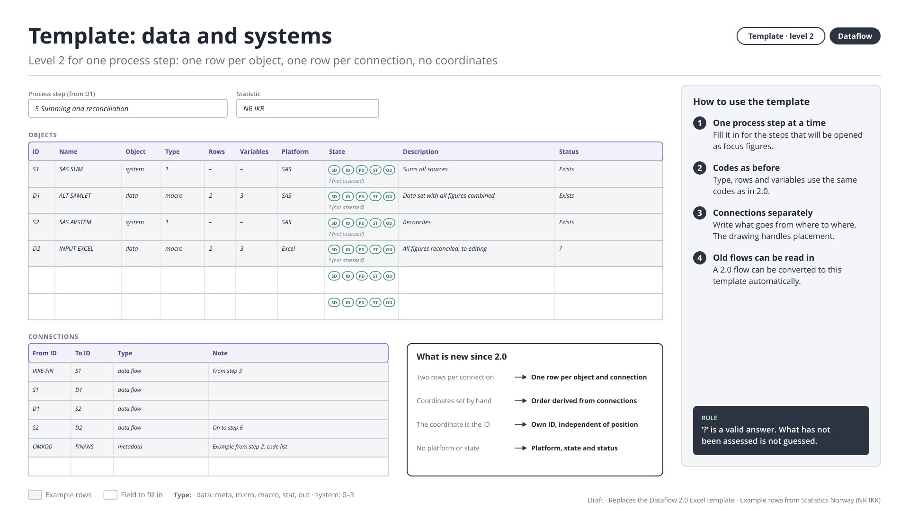

# Template D2: Data and systems

Level 2: the data sets and systems in each process step, and the connections between them. Replaces the Dataflow 2.0 Excel template. The template is based on [figure D2](../5-how-to-map.md#figure-d2).

!!! info "How to fill it in"

    1. **Take one process step at a time,** and write the step number from D1 in the first column.
    2. **Choose type, rows and variables** with the same codes as in Dataflow 2.0.
    3. **Write the connections** with the IDs from the object table.
    4. **Stable state** is where the data set is stored in an agreed state. Choose ‘?’ if you do not know.

    Your answers are stored only in this browser. When you are done, select **Make text for the AI assistant** and paste the text into your assistant. You can also download your answers or make a backup from the [overview](index.md#your-answers).

!!! warning "Do not enter information that must not be shared"
    The templates describe systems, data sets and processes, not people or figures. Do not enter personal data, unpublished figures, passwords or access information. The text you make is meant for an AI tool: follow your organisation's guidelines for using AI.

<button type="button" class="md-button md-button--primary" data-do="ai">Make text for the AI assistant</button><button type="button" class="md-button" data-do="copy">Copy answers</button><button type="button" class="md-button" data-do="download">Download (.md)</button><button type="button" class="md-button" data-do="print">Print</button><button type="button" class="md-button tmpl-clear" data-do="clear">Clear template</button>

Text for the AI assistant. Copy it into a conversation, together with a Dataflow 2.0 Excel file if you have one.
<textarea readonly rows="8" aria-label="Text for the AI assistant"></textarea><button type="button" class="md-button" data-do="copyai">Copy the text</button>
<form class="tmpl-form" onsubmit="return false"><datalist id="platforms"><option value="SAS"><option value="FAME"><option value="Oracle"><option value="Excel"><option value="R"><option value="Python"><option value="SQL database"><option value="Survey tool"><option value="Web portal"><option value="Cloud platform"></datalist><datalist id="roles"><option value="statistician"><option value="statistics owner"><option value="methodologist"><option value="IT / developer"><option value="dissemination"><option value="external supplier"></datalist><section class="tmpl-part tmpl-common"><h3>About the statistic (shared by all templates)</h3>
<label class="tmpl-field">Statistic<input type="text" data-k="common.statistic" data-l="Statistic" placeholder="Example: Income and capital accounts"></label><label class="tmpl-field">Short name<input type="text" data-k="common.short" data-l="Short name" placeholder="Example: NR IKR"></label><label class="tmpl-field">Organisational unit<input type="text" data-k="common.unit" data-l="Organisational unit" placeholder="Example: National accounts division"></label><label class="tmpl-field">Contact person<input type="text" data-k="common.contact" data-l="Contact person" placeholder="Role or name"></label>

<label class="tmpl-field">Does the template cover one statistic or a group?<select data-k="common.scope" data-l="Applies to"><option value=""></option><option value="one">One statistic</option><option value="group">A group of statistics</option></select></label><label class="tmpl-field">Statistics in the group<input type="text" data-k="common.group" data-l="Statistics in the group" placeholder="Groups only: short names or initials"></label><label class="tmpl-field">Date<input type="text" data-k="common.date" data-l="Date" placeholder="Example: 26 Nov 2026"></label>
</section><section class="tmpl-part "><h3>The process steps</h3>
The process steps from template D1
–

</section><section class="tmpl-part "><h3>Objects: data and systems</h3>
One row per data set or system. The ID is free but must be unique (for example S1, S2 for systems and D1, D2 for data). The same system can appear more than once if it is used in several places.

<table class="tmpl-t"><thead><tr><th>#</th><th>Step</th><th>ID</th><th>Name</th><th>Object</th><th>Type</th><th>Rows</th><th>Variables</th><th>Platform</th><th>Stable state</th><th>Description</th><th>Status</th></tr></thead><tbody><tr><td class="tmpl-nr">1</td><td style="min-width:4em"><input type="text" data-k="D2.obj.1.step" data-l="Step" placeholder="5"></td><td style="min-width:5em"><input type="text" data-k="D2.obj.1.id" data-l="ID" placeholder="S1"></td><td style="min-width:10em"><input type="text" data-k="D2.obj.1.name" data-l="Name" placeholder="SAS SUM"></td><td style="min-width:6em"><select data-k="D2.obj.1.object" data-l="Object"><option value=""></option><option value="data">data</option><option value="system">system</option></select></td><td style="min-width:11em"><select data-k="D2.obj.1.type" data-l="Type"><option value=""></option><option value="meta">meta · metadata</option><option value="micro">micro · micro data</option><option value="macro">macro · macro data</option><option value="stat">stat · statistics</option><option value="out">out · output</option><option value="qual">qual · quality indicator</option><option value="sys0">system 0 · next level</option><option value="sys1">system 1 · bespoke code</option><option value="sys2">system 2 · framework with menu</option><option value="sys3">system 3 · framework</option><option value="?">?</option></select></td><td style="min-width:7em"><select data-k="D2.obj.1.rows" data-l="Rows"><option value=""></option><option value="1">1 · little</option><option value="2">2 · medium</option><option value="3">3 · much</option><option value="?">?</option></select></td><td style="min-width:8em"><select data-k="D2.obj.1.vars" data-l="Variables"><option value=""></option><option value="1">1 · very few</option><option value="2">2 · few</option><option value="3">3 · many</option><option value="4">4 · very many</option><option value="?">?</option></select></td><td style="min-width:8em"><input type="text" data-k="D2.obj.1.platform" data-l="Platform" placeholder="SAS" list="platforms"></td><td style="min-width:9em"><select data-k="D2.obj.1.state" data-l="Stable state"><option value=""></option><option value="SD">SD · source data</option><option value="ID">ID · input data</option><option value="PD">PD · processed data</option><option value="ST">ST · statistics</option><option value="OD">OD · output data</option><option value="none">none</option><option value="?">?</option></select></td><td style="min-width:14em"><textarea data-k="D2.obj.1.desc" data-l="Description" rows="1" placeholder="Sums all sources"></textarea></td><td style="min-width:7em"><select data-k="D2.obj.1.status" data-l="Status"><option value=""></option><option value="exists">exists</option><option value="in progress">in progress</option><option value="proposal">proposal</option><option value="?">?</option></select></td></tr><tr><td class="tmpl-nr">2</td><td style="min-width:4em"><input type="text" data-k="D2.obj.2.step" data-l="Step"></td><td style="min-width:5em"><input type="text" data-k="D2.obj.2.id" data-l="ID"></td><td style="min-width:10em"><input type="text" data-k="D2.obj.2.name" data-l="Name"></td><td style="min-width:6em"><select data-k="D2.obj.2.object" data-l="Object"><option value=""></option><option value="data">data</option><option value="system">system</option></select></td><td style="min-width:11em"><select data-k="D2.obj.2.type" data-l="Type"><option value=""></option><option value="meta">meta · metadata</option><option value="micro">micro · micro data</option><option value="macro">macro · macro data</option><option value="stat">stat · statistics</option><option value="out">out · output</option><option value="qual">qual · quality indicator</option><option value="sys0">system 0 · next level</option><option value="sys1">system 1 · bespoke code</option><option value="sys2">system 2 · framework with menu</option><option value="sys3">system 3 · framework</option><option value="?">?</option></select></td><td style="min-width:7em"><select data-k="D2.obj.2.rows" data-l="Rows"><option value=""></option><option value="1">1 · little</option><option value="2">2 · medium</option><option value="3">3 · much</option><option value="?">?</option></select></td><td style="min-width:8em"><select data-k="D2.obj.2.vars" data-l="Variables"><option value=""></option><option value="1">1 · very few</option><option value="2">2 · few</option><option value="3">3 · many</option><option value="4">4 · very many</option><option value="?">?</option></select></td><td style="min-width:8em"><input type="text" data-k="D2.obj.2.platform" data-l="Platform" list="platforms"></td><td style="min-width:9em"><select data-k="D2.obj.2.state" data-l="Stable state"><option value=""></option><option value="SD">SD · source data</option><option value="ID">ID · input data</option><option value="PD">PD · processed data</option><option value="ST">ST · statistics</option><option value="OD">OD · output data</option><option value="none">none</option><option value="?">?</option></select></td><td style="min-width:14em"><textarea data-k="D2.obj.2.desc" data-l="Description" rows="1"></textarea></td><td style="min-width:7em"><select data-k="D2.obj.2.status" data-l="Status"><option value=""></option><option value="exists">exists</option><option value="in progress">in progress</option><option value="proposal">proposal</option><option value="?">?</option></select></td></tr><tr><td class="tmpl-nr">3</td><td style="min-width:4em"><input type="text" data-k="D2.obj.3.step" data-l="Step"></td><td style="min-width:5em"><input type="text" data-k="D2.obj.3.id" data-l="ID"></td><td style="min-width:10em"><input type="text" data-k="D2.obj.3.name" data-l="Name"></td><td style="min-width:6em"><select data-k="D2.obj.3.object" data-l="Object"><option value=""></option><option value="data">data</option><option value="system">system</option></select></td><td style="min-width:11em"><select data-k="D2.obj.3.type" data-l="Type"><option value=""></option><option value="meta">meta · metadata</option><option value="micro">micro · micro data</option><option value="macro">macro · macro data</option><option value="stat">stat · statistics</option><option value="out">out · output</option><option value="qual">qual · quality indicator</option><option value="sys0">system 0 · next level</option><option value="sys1">system 1 · bespoke code</option><option value="sys2">system 2 · framework with menu</option><option value="sys3">system 3 · framework</option><option value="?">?</option></select></td><td style="min-width:7em"><select data-k="D2.obj.3.rows" data-l="Rows"><option value=""></option><option value="1">1 · little</option><option value="2">2 · medium</option><option value="3">3 · much</option><option value="?">?</option></select></td><td style="min-width:8em"><select data-k="D2.obj.3.vars" data-l="Variables"><option value=""></option><option value="1">1 · very few</option><option value="2">2 · few</option><option value="3">3 · many</option><option value="4">4 · very many</option><option value="?">?</option></select></td><td style="min-width:8em"><input type="text" data-k="D2.obj.3.platform" data-l="Platform" list="platforms"></td><td style="min-width:9em"><select data-k="D2.obj.3.state" data-l="Stable state"><option value=""></option><option value="SD">SD · source data</option><option value="ID">ID · input data</option><option value="PD">PD · processed data</option><option value="ST">ST · statistics</option><option value="OD">OD · output data</option><option value="none">none</option><option value="?">?</option></select></td><td style="min-width:14em"><textarea data-k="D2.obj.3.desc" data-l="Description" rows="1"></textarea></td><td style="min-width:7em"><select data-k="D2.obj.3.status" data-l="Status"><option value=""></option><option value="exists">exists</option><option value="in progress">in progress</option><option value="proposal">proposal</option><option value="?">?</option></select></td></tr><tr><td class="tmpl-nr">4</td><td style="min-width:4em"><input type="text" data-k="D2.obj.4.step" data-l="Step"></td><td style="min-width:5em"><input type="text" data-k="D2.obj.4.id" data-l="ID"></td><td style="min-width:10em"><input type="text" data-k="D2.obj.4.name" data-l="Name"></td><td style="min-width:6em"><select data-k="D2.obj.4.object" data-l="Object"><option value=""></option><option value="data">data</option><option value="system">system</option></select></td><td style="min-width:11em"><select data-k="D2.obj.4.type" data-l="Type"><option value=""></option><option value="meta">meta · metadata</option><option value="micro">micro · micro data</option><option value="macro">macro · macro data</option><option value="stat">stat · statistics</option><option value="out">out · output</option><option value="qual">qual · quality indicator</option><option value="sys0">system 0 · next level</option><option value="sys1">system 1 · bespoke code</option><option value="sys2">system 2 · framework with menu</option><option value="sys3">system 3 · framework</option><option value="?">?</option></select></td><td style="min-width:7em"><select data-k="D2.obj.4.rows" data-l="Rows"><option value=""></option><option value="1">1 · little</option><option value="2">2 · medium</option><option value="3">3 · much</option><option value="?">?</option></select></td><td style="min-width:8em"><select data-k="D2.obj.4.vars" data-l="Variables"><option value=""></option><option value="1">1 · very few</option><option value="2">2 · few</option><option value="3">3 · many</option><option value="4">4 · very many</option><option value="?">?</option></select></td><td style="min-width:8em"><input type="text" data-k="D2.obj.4.platform" data-l="Platform" list="platforms"></td><td style="min-width:9em"><select data-k="D2.obj.4.state" data-l="Stable state"><option value=""></option><option value="SD">SD · source data</option><option value="ID">ID · input data</option><option value="PD">PD · processed data</option><option value="ST">ST · statistics</option><option value="OD">OD · output data</option><option value="none">none</option><option value="?">?</option></select></td><td style="min-width:14em"><textarea data-k="D2.obj.4.desc" data-l="Description" rows="1"></textarea></td><td style="min-width:7em"><select data-k="D2.obj.4.status" data-l="Status"><option value=""></option><option value="exists">exists</option><option value="in progress">in progress</option><option value="proposal">proposal</option><option value="?">?</option></select></td></tr><tr><td class="tmpl-nr">5</td><td style="min-width:4em"><input type="text" data-k="D2.obj.5.step" data-l="Step"></td><td style="min-width:5em"><input type="text" data-k="D2.obj.5.id" data-l="ID"></td><td style="min-width:10em"><input type="text" data-k="D2.obj.5.name" data-l="Name"></td><td style="min-width:6em"><select data-k="D2.obj.5.object" data-l="Object"><option value=""></option><option value="data">data</option><option value="system">system</option></select></td><td style="min-width:11em"><select data-k="D2.obj.5.type" data-l="Type"><option value=""></option><option value="meta">meta · metadata</option><option value="micro">micro · micro data</option><option value="macro">macro · macro data</option><option value="stat">stat · statistics</option><option value="out">out · output</option><option value="qual">qual · quality indicator</option><option value="sys0">system 0 · next level</option><option value="sys1">system 1 · bespoke code</option><option value="sys2">system 2 · framework with menu</option><option value="sys3">system 3 · framework</option><option value="?">?</option></select></td><td style="min-width:7em"><select data-k="D2.obj.5.rows" data-l="Rows"><option value=""></option><option value="1">1 · little</option><option value="2">2 · medium</option><option value="3">3 · much</option><option value="?">?</option></select></td><td style="min-width:8em"><select data-k="D2.obj.5.vars" data-l="Variables"><option value=""></option><option value="1">1 · very few</option><option value="2">2 · few</option><option value="3">3 · many</option><option value="4">4 · very many</option><option value="?">?</option></select></td><td style="min-width:8em"><input type="text" data-k="D2.obj.5.platform" data-l="Platform" list="platforms"></td><td style="min-width:9em"><select data-k="D2.obj.5.state" data-l="Stable state"><option value=""></option><option value="SD">SD · source data</option><option value="ID">ID · input data</option><option value="PD">PD · processed data</option><option value="ST">ST · statistics</option><option value="OD">OD · output data</option><option value="none">none</option><option value="?">?</option></select></td><td style="min-width:14em"><textarea data-k="D2.obj.5.desc" data-l="Description" rows="1"></textarea></td><td style="min-width:7em"><select data-k="D2.obj.5.status" data-l="Status"><option value=""></option><option value="exists">exists</option><option value="in progress">in progress</option><option value="proposal">proposal</option><option value="?">?</option></select></td></tr><tr><td class="tmpl-nr">6</td><td style="min-width:4em"><input type="text" data-k="D2.obj.6.step" data-l="Step"></td><td style="min-width:5em"><input type="text" data-k="D2.obj.6.id" data-l="ID"></td><td style="min-width:10em"><input type="text" data-k="D2.obj.6.name" data-l="Name"></td><td style="min-width:6em"><select data-k="D2.obj.6.object" data-l="Object"><option value=""></option><option value="data">data</option><option value="system">system</option></select></td><td style="min-width:11em"><select data-k="D2.obj.6.type" data-l="Type"><option value=""></option><option value="meta">meta · metadata</option><option value="micro">micro · micro data</option><option value="macro">macro · macro data</option><option value="stat">stat · statistics</option><option value="out">out · output</option><option value="qual">qual · quality indicator</option><option value="sys0">system 0 · next level</option><option value="sys1">system 1 · bespoke code</option><option value="sys2">system 2 · framework with menu</option><option value="sys3">system 3 · framework</option><option value="?">?</option></select></td><td style="min-width:7em"><select data-k="D2.obj.6.rows" data-l="Rows"><option value=""></option><option value="1">1 · little</option><option value="2">2 · medium</option><option value="3">3 · much</option><option value="?">?</option></select></td><td style="min-width:8em"><select data-k="D2.obj.6.vars" data-l="Variables"><option value=""></option><option value="1">1 · very few</option><option value="2">2 · few</option><option value="3">3 · many</option><option value="4">4 · very many</option><option value="?">?</option></select></td><td style="min-width:8em"><input type="text" data-k="D2.obj.6.platform" data-l="Platform" list="platforms"></td><td style="min-width:9em"><select data-k="D2.obj.6.state" data-l="Stable state"><option value=""></option><option value="SD">SD · source data</option><option value="ID">ID · input data</option><option value="PD">PD · processed data</option><option value="ST">ST · statistics</option><option value="OD">OD · output data</option><option value="none">none</option><option value="?">?</option></select></td><td style="min-width:14em"><textarea data-k="D2.obj.6.desc" data-l="Description" rows="1"></textarea></td><td style="min-width:7em"><select data-k="D2.obj.6.status" data-l="Status"><option value=""></option><option value="exists">exists</option><option value="in progress">in progress</option><option value="proposal">proposal</option><option value="?">?</option></select></td></tr><tr><td class="tmpl-nr">7</td><td style="min-width:4em"><input type="text" data-k="D2.obj.7.step" data-l="Step"></td><td style="min-width:5em"><input type="text" data-k="D2.obj.7.id" data-l="ID"></td><td style="min-width:10em"><input type="text" data-k="D2.obj.7.name" data-l="Name"></td><td style="min-width:6em"><select data-k="D2.obj.7.object" data-l="Object"><option value=""></option><option value="data">data</option><option value="system">system</option></select></td><td style="min-width:11em"><select data-k="D2.obj.7.type" data-l="Type"><option value=""></option><option value="meta">meta · metadata</option><option value="micro">micro · micro data</option><option value="macro">macro · macro data</option><option value="stat">stat · statistics</option><option value="out">out · output</option><option value="qual">qual · quality indicator</option><option value="sys0">system 0 · next level</option><option value="sys1">system 1 · bespoke code</option><option value="sys2">system 2 · framework with menu</option><option value="sys3">system 3 · framework</option><option value="?">?</option></select></td><td style="min-width:7em"><select data-k="D2.obj.7.rows" data-l="Rows"><option value=""></option><option value="1">1 · little</option><option value="2">2 · medium</option><option value="3">3 · much</option><option value="?">?</option></select></td><td style="min-width:8em"><select data-k="D2.obj.7.vars" data-l="Variables"><option value=""></option><option value="1">1 · very few</option><option value="2">2 · few</option><option value="3">3 · many</option><option value="4">4 · very many</option><option value="?">?</option></select></td><td style="min-width:8em"><input type="text" data-k="D2.obj.7.platform" data-l="Platform" list="platforms"></td><td style="min-width:9em"><select data-k="D2.obj.7.state" data-l="Stable state"><option value=""></option><option value="SD">SD · source data</option><option value="ID">ID · input data</option><option value="PD">PD · processed data</option><option value="ST">ST · statistics</option><option value="OD">OD · output data</option><option value="none">none</option><option value="?">?</option></select></td><td style="min-width:14em"><textarea data-k="D2.obj.7.desc" data-l="Description" rows="1"></textarea></td><td style="min-width:7em"><select data-k="D2.obj.7.status" data-l="Status"><option value=""></option><option value="exists">exists</option><option value="in progress">in progress</option><option value="proposal">proposal</option><option value="?">?</option></select></td></tr><tr><td class="tmpl-nr">8</td><td style="min-width:4em"><input type="text" data-k="D2.obj.8.step" data-l="Step"></td><td style="min-width:5em"><input type="text" data-k="D2.obj.8.id" data-l="ID"></td><td style="min-width:10em"><input type="text" data-k="D2.obj.8.name" data-l="Name"></td><td style="min-width:6em"><select data-k="D2.obj.8.object" data-l="Object"><option value=""></option><option value="data">data</option><option value="system">system</option></select></td><td style="min-width:11em"><select data-k="D2.obj.8.type" data-l="Type"><option value=""></option><option value="meta">meta · metadata</option><option value="micro">micro · micro data</option><option value="macro">macro · macro data</option><option value="stat">stat · statistics</option><option value="out">out · output</option><option value="qual">qual · quality indicator</option><option value="sys0">system 0 · next level</option><option value="sys1">system 1 · bespoke code</option><option value="sys2">system 2 · framework with menu</option><option value="sys3">system 3 · framework</option><option value="?">?</option></select></td><td style="min-width:7em"><select data-k="D2.obj.8.rows" data-l="Rows"><option value=""></option><option value="1">1 · little</option><option value="2">2 · medium</option><option value="3">3 · much</option><option value="?">?</option></select></td><td style="min-width:8em"><select data-k="D2.obj.8.vars" data-l="Variables"><option value=""></option><option value="1">1 · very few</option><option value="2">2 · few</option><option value="3">3 · many</option><option value="4">4 · very many</option><option value="?">?</option></select></td><td style="min-width:8em"><input type="text" data-k="D2.obj.8.platform" data-l="Platform" list="platforms"></td><td style="min-width:9em"><select data-k="D2.obj.8.state" data-l="Stable state"><option value=""></option><option value="SD">SD · source data</option><option value="ID">ID · input data</option><option value="PD">PD · processed data</option><option value="ST">ST · statistics</option><option value="OD">OD · output data</option><option value="none">none</option><option value="?">?</option></select></td><td style="min-width:14em"><textarea data-k="D2.obj.8.desc" data-l="Description" rows="1"></textarea></td><td style="min-width:7em"><select data-k="D2.obj.8.status" data-l="Status"><option value=""></option><option value="exists">exists</option><option value="in progress">in progress</option><option value="proposal">proposal</option><option value="?">?</option></select></td></tr><tr><td class="tmpl-nr">9</td><td style="min-width:4em"><input type="text" data-k="D2.obj.9.step" data-l="Step"></td><td style="min-width:5em"><input type="text" data-k="D2.obj.9.id" data-l="ID"></td><td style="min-width:10em"><input type="text" data-k="D2.obj.9.name" data-l="Name"></td><td style="min-width:6em"><select data-k="D2.obj.9.object" data-l="Object"><option value=""></option><option value="data">data</option><option value="system">system</option></select></td><td style="min-width:11em"><select data-k="D2.obj.9.type" data-l="Type"><option value=""></option><option value="meta">meta · metadata</option><option value="micro">micro · micro data</option><option value="macro">macro · macro data</option><option value="stat">stat · statistics</option><option value="out">out · output</option><option value="qual">qual · quality indicator</option><option value="sys0">system 0 · next level</option><option value="sys1">system 1 · bespoke code</option><option value="sys2">system 2 · framework with menu</option><option value="sys3">system 3 · framework</option><option value="?">?</option></select></td><td style="min-width:7em"><select data-k="D2.obj.9.rows" data-l="Rows"><option value=""></option><option value="1">1 · little</option><option value="2">2 · medium</option><option value="3">3 · much</option><option value="?">?</option></select></td><td style="min-width:8em"><select data-k="D2.obj.9.vars" data-l="Variables"><option value=""></option><option value="1">1 · very few</option><option value="2">2 · few</option><option value="3">3 · many</option><option value="4">4 · very many</option><option value="?">?</option></select></td><td style="min-width:8em"><input type="text" data-k="D2.obj.9.platform" data-l="Platform" list="platforms"></td><td style="min-width:9em"><select data-k="D2.obj.9.state" data-l="Stable state"><option value=""></option><option value="SD">SD · source data</option><option value="ID">ID · input data</option><option value="PD">PD · processed data</option><option value="ST">ST · statistics</option><option value="OD">OD · output data</option><option value="none">none</option><option value="?">?</option></select></td><td style="min-width:14em"><textarea data-k="D2.obj.9.desc" data-l="Description" rows="1"></textarea></td><td style="min-width:7em"><select data-k="D2.obj.9.status" data-l="Status"><option value=""></option><option value="exists">exists</option><option value="in progress">in progress</option><option value="proposal">proposal</option><option value="?">?</option></select></td></tr><tr><td class="tmpl-nr">10</td><td style="min-width:4em"><input type="text" data-k="D2.obj.10.step" data-l="Step"></td><td style="min-width:5em"><input type="text" data-k="D2.obj.10.id" data-l="ID"></td><td style="min-width:10em"><input type="text" data-k="D2.obj.10.name" data-l="Name"></td><td style="min-width:6em"><select data-k="D2.obj.10.object" data-l="Object"><option value=""></option><option value="data">data</option><option value="system">system</option></select></td><td style="min-width:11em"><select data-k="D2.obj.10.type" data-l="Type"><option value=""></option><option value="meta">meta · metadata</option><option value="micro">micro · micro data</option><option value="macro">macro · macro data</option><option value="stat">stat · statistics</option><option value="out">out · output</option><option value="qual">qual · quality indicator</option><option value="sys0">system 0 · next level</option><option value="sys1">system 1 · bespoke code</option><option value="sys2">system 2 · framework with menu</option><option value="sys3">system 3 · framework</option><option value="?">?</option></select></td><td style="min-width:7em"><select data-k="D2.obj.10.rows" data-l="Rows"><option value=""></option><option value="1">1 · little</option><option value="2">2 · medium</option><option value="3">3 · much</option><option value="?">?</option></select></td><td style="min-width:8em"><select data-k="D2.obj.10.vars" data-l="Variables"><option value=""></option><option value="1">1 · very few</option><option value="2">2 · few</option><option value="3">3 · many</option><option value="4">4 · very many</option><option value="?">?</option></select></td><td style="min-width:8em"><input type="text" data-k="D2.obj.10.platform" data-l="Platform" list="platforms"></td><td style="min-width:9em"><select data-k="D2.obj.10.state" data-l="Stable state"><option value=""></option><option value="SD">SD · source data</option><option value="ID">ID · input data</option><option value="PD">PD · processed data</option><option value="ST">ST · statistics</option><option value="OD">OD · output data</option><option value="none">none</option><option value="?">?</option></select></td><td style="min-width:14em"><textarea data-k="D2.obj.10.desc" data-l="Description" rows="1"></textarea></td><td style="min-width:7em"><select data-k="D2.obj.10.status" data-l="Status"><option value=""></option><option value="exists">exists</option><option value="in progress">in progress</option><option value="proposal">proposal</option><option value="?">?</option></select></td></tr><tr><td class="tmpl-nr">11</td><td style="min-width:4em"><input type="text" data-k="D2.obj.11.step" data-l="Step"></td><td style="min-width:5em"><input type="text" data-k="D2.obj.11.id" data-l="ID"></td><td style="min-width:10em"><input type="text" data-k="D2.obj.11.name" data-l="Name"></td><td style="min-width:6em"><select data-k="D2.obj.11.object" data-l="Object"><option value=""></option><option value="data">data</option><option value="system">system</option></select></td><td style="min-width:11em"><select data-k="D2.obj.11.type" data-l="Type"><option value=""></option><option value="meta">meta · metadata</option><option value="micro">micro · micro data</option><option value="macro">macro · macro data</option><option value="stat">stat · statistics</option><option value="out">out · output</option><option value="qual">qual · quality indicator</option><option value="sys0">system 0 · next level</option><option value="sys1">system 1 · bespoke code</option><option value="sys2">system 2 · framework with menu</option><option value="sys3">system 3 · framework</option><option value="?">?</option></select></td><td style="min-width:7em"><select data-k="D2.obj.11.rows" data-l="Rows"><option value=""></option><option value="1">1 · little</option><option value="2">2 · medium</option><option value="3">3 · much</option><option value="?">?</option></select></td><td style="min-width:8em"><select data-k="D2.obj.11.vars" data-l="Variables"><option value=""></option><option value="1">1 · very few</option><option value="2">2 · few</option><option value="3">3 · many</option><option value="4">4 · very many</option><option value="?">?</option></select></td><td style="min-width:8em"><input type="text" data-k="D2.obj.11.platform" data-l="Platform" list="platforms"></td><td style="min-width:9em"><select data-k="D2.obj.11.state" data-l="Stable state"><option value=""></option><option value="SD">SD · source data</option><option value="ID">ID · input data</option><option value="PD">PD · processed data</option><option value="ST">ST · statistics</option><option value="OD">OD · output data</option><option value="none">none</option><option value="?">?</option></select></td><td style="min-width:14em"><textarea data-k="D2.obj.11.desc" data-l="Description" rows="1"></textarea></td><td style="min-width:7em"><select data-k="D2.obj.11.status" data-l="Status"><option value=""></option><option value="exists">exists</option><option value="in progress">in progress</option><option value="proposal">proposal</option><option value="?">?</option></select></td></tr><tr><td class="tmpl-nr">12</td><td style="min-width:4em"><input type="text" data-k="D2.obj.12.step" data-l="Step"></td><td style="min-width:5em"><input type="text" data-k="D2.obj.12.id" data-l="ID"></td><td style="min-width:10em"><input type="text" data-k="D2.obj.12.name" data-l="Name"></td><td style="min-width:6em"><select data-k="D2.obj.12.object" data-l="Object"><option value=""></option><option value="data">data</option><option value="system">system</option></select></td><td style="min-width:11em"><select data-k="D2.obj.12.type" data-l="Type"><option value=""></option><option value="meta">meta · metadata</option><option value="micro">micro · micro data</option><option value="macro">macro · macro data</option><option value="stat">stat · statistics</option><option value="out">out · output</option><option value="qual">qual · quality indicator</option><option value="sys0">system 0 · next level</option><option value="sys1">system 1 · bespoke code</option><option value="sys2">system 2 · framework with menu</option><option value="sys3">system 3 · framework</option><option value="?">?</option></select></td><td style="min-width:7em"><select data-k="D2.obj.12.rows" data-l="Rows"><option value=""></option><option value="1">1 · little</option><option value="2">2 · medium</option><option value="3">3 · much</option><option value="?">?</option></select></td><td style="min-width:8em"><select data-k="D2.obj.12.vars" data-l="Variables"><option value=""></option><option value="1">1 · very few</option><option value="2">2 · few</option><option value="3">3 · many</option><option value="4">4 · very many</option><option value="?">?</option></select></td><td style="min-width:8em"><input type="text" data-k="D2.obj.12.platform" data-l="Platform" list="platforms"></td><td style="min-width:9em"><select data-k="D2.obj.12.state" data-l="Stable state"><option value=""></option><option value="SD">SD · source data</option><option value="ID">ID · input data</option><option value="PD">PD · processed data</option><option value="ST">ST · statistics</option><option value="OD">OD · output data</option><option value="none">none</option><option value="?">?</option></select></td><td style="min-width:14em"><textarea data-k="D2.obj.12.desc" data-l="Description" rows="1"></textarea></td><td style="min-width:7em"><select data-k="D2.obj.12.status" data-l="Status"><option value=""></option><option value="exists">exists</option><option value="in progress">in progress</option><option value="proposal">proposal</option><option value="?">?</option></select></td></tr><tr><td class="tmpl-nr">13</td><td style="min-width:4em"><input type="text" data-k="D2.obj.13.step" data-l="Step"></td><td style="min-width:5em"><input type="text" data-k="D2.obj.13.id" data-l="ID"></td><td style="min-width:10em"><input type="text" data-k="D2.obj.13.name" data-l="Name"></td><td style="min-width:6em"><select data-k="D2.obj.13.object" data-l="Object"><option value=""></option><option value="data">data</option><option value="system">system</option></select></td><td style="min-width:11em"><select data-k="D2.obj.13.type" data-l="Type"><option value=""></option><option value="meta">meta · metadata</option><option value="micro">micro · micro data</option><option value="macro">macro · macro data</option><option value="stat">stat · statistics</option><option value="out">out · output</option><option value="qual">qual · quality indicator</option><option value="sys0">system 0 · next level</option><option value="sys1">system 1 · bespoke code</option><option value="sys2">system 2 · framework with menu</option><option value="sys3">system 3 · framework</option><option value="?">?</option></select></td><td style="min-width:7em"><select data-k="D2.obj.13.rows" data-l="Rows"><option value=""></option><option value="1">1 · little</option><option value="2">2 · medium</option><option value="3">3 · much</option><option value="?">?</option></select></td><td style="min-width:8em"><select data-k="D2.obj.13.vars" data-l="Variables"><option value=""></option><option value="1">1 · very few</option><option value="2">2 · few</option><option value="3">3 · many</option><option value="4">4 · very many</option><option value="?">?</option></select></td><td style="min-width:8em"><input type="text" data-k="D2.obj.13.platform" data-l="Platform" list="platforms"></td><td style="min-width:9em"><select data-k="D2.obj.13.state" data-l="Stable state"><option value=""></option><option value="SD">SD · source data</option><option value="ID">ID · input data</option><option value="PD">PD · processed data</option><option value="ST">ST · statistics</option><option value="OD">OD · output data</option><option value="none">none</option><option value="?">?</option></select></td><td style="min-width:14em"><textarea data-k="D2.obj.13.desc" data-l="Description" rows="1"></textarea></td><td style="min-width:7em"><select data-k="D2.obj.13.status" data-l="Status"><option value=""></option><option value="exists">exists</option><option value="in progress">in progress</option><option value="proposal">proposal</option><option value="?">?</option></select></td></tr><tr><td class="tmpl-nr">14</td><td style="min-width:4em"><input type="text" data-k="D2.obj.14.step" data-l="Step"></td><td style="min-width:5em"><input type="text" data-k="D2.obj.14.id" data-l="ID"></td><td style="min-width:10em"><input type="text" data-k="D2.obj.14.name" data-l="Name"></td><td style="min-width:6em"><select data-k="D2.obj.14.object" data-l="Object"><option value=""></option><option value="data">data</option><option value="system">system</option></select></td><td style="min-width:11em"><select data-k="D2.obj.14.type" data-l="Type"><option value=""></option><option value="meta">meta · metadata</option><option value="micro">micro · micro data</option><option value="macro">macro · macro data</option><option value="stat">stat · statistics</option><option value="out">out · output</option><option value="qual">qual · quality indicator</option><option value="sys0">system 0 · next level</option><option value="sys1">system 1 · bespoke code</option><option value="sys2">system 2 · framework with menu</option><option value="sys3">system 3 · framework</option><option value="?">?</option></select></td><td style="min-width:7em"><select data-k="D2.obj.14.rows" data-l="Rows"><option value=""></option><option value="1">1 · little</option><option value="2">2 · medium</option><option value="3">3 · much</option><option value="?">?</option></select></td><td style="min-width:8em"><select data-k="D2.obj.14.vars" data-l="Variables"><option value=""></option><option value="1">1 · very few</option><option value="2">2 · few</option><option value="3">3 · many</option><option value="4">4 · very many</option><option value="?">?</option></select></td><td style="min-width:8em"><input type="text" data-k="D2.obj.14.platform" data-l="Platform" list="platforms"></td><td style="min-width:9em"><select data-k="D2.obj.14.state" data-l="Stable state"><option value=""></option><option value="SD">SD · source data</option><option value="ID">ID · input data</option><option value="PD">PD · processed data</option><option value="ST">ST · statistics</option><option value="OD">OD · output data</option><option value="none">none</option><option value="?">?</option></select></td><td style="min-width:14em"><textarea data-k="D2.obj.14.desc" data-l="Description" rows="1"></textarea></td><td style="min-width:7em"><select data-k="D2.obj.14.status" data-l="Status"><option value=""></option><option value="exists">exists</option><option value="in progress">in progress</option><option value="proposal">proposal</option><option value="?">?</option></select></td></tr><tr><td class="tmpl-nr">15</td><td style="min-width:4em"><input type="text" data-k="D2.obj.15.step" data-l="Step"></td><td style="min-width:5em"><input type="text" data-k="D2.obj.15.id" data-l="ID"></td><td style="min-width:10em"><input type="text" data-k="D2.obj.15.name" data-l="Name"></td><td style="min-width:6em"><select data-k="D2.obj.15.object" data-l="Object"><option value=""></option><option value="data">data</option><option value="system">system</option></select></td><td style="min-width:11em"><select data-k="D2.obj.15.type" data-l="Type"><option value=""></option><option value="meta">meta · metadata</option><option value="micro">micro · micro data</option><option value="macro">macro · macro data</option><option value="stat">stat · statistics</option><option value="out">out · output</option><option value="qual">qual · quality indicator</option><option value="sys0">system 0 · next level</option><option value="sys1">system 1 · bespoke code</option><option value="sys2">system 2 · framework with menu</option><option value="sys3">system 3 · framework</option><option value="?">?</option></select></td><td style="min-width:7em"><select data-k="D2.obj.15.rows" data-l="Rows"><option value=""></option><option value="1">1 · little</option><option value="2">2 · medium</option><option value="3">3 · much</option><option value="?">?</option></select></td><td style="min-width:8em"><select data-k="D2.obj.15.vars" data-l="Variables"><option value=""></option><option value="1">1 · very few</option><option value="2">2 · few</option><option value="3">3 · many</option><option value="4">4 · very many</option><option value="?">?</option></select></td><td style="min-width:8em"><input type="text" data-k="D2.obj.15.platform" data-l="Platform" list="platforms"></td><td style="min-width:9em"><select data-k="D2.obj.15.state" data-l="Stable state"><option value=""></option><option value="SD">SD · source data</option><option value="ID">ID · input data</option><option value="PD">PD · processed data</option><option value="ST">ST · statistics</option><option value="OD">OD · output data</option><option value="none">none</option><option value="?">?</option></select></td><td style="min-width:14em"><textarea data-k="D2.obj.15.desc" data-l="Description" rows="1"></textarea></td><td style="min-width:7em"><select data-k="D2.obj.15.status" data-l="Status"><option value=""></option><option value="exists">exists</option><option value="in progress">in progress</option><option value="proposal">proposal</option><option value="?">?</option></select></td></tr><tr><td class="tmpl-nr">16</td><td style="min-width:4em"><input type="text" data-k="D2.obj.16.step" data-l="Step"></td><td style="min-width:5em"><input type="text" data-k="D2.obj.16.id" data-l="ID"></td><td style="min-width:10em"><input type="text" data-k="D2.obj.16.name" data-l="Name"></td><td style="min-width:6em"><select data-k="D2.obj.16.object" data-l="Object"><option value=""></option><option value="data">data</option><option value="system">system</option></select></td><td style="min-width:11em"><select data-k="D2.obj.16.type" data-l="Type"><option value=""></option><option value="meta">meta · metadata</option><option value="micro">micro · micro data</option><option value="macro">macro · macro data</option><option value="stat">stat · statistics</option><option value="out">out · output</option><option value="qual">qual · quality indicator</option><option value="sys0">system 0 · next level</option><option value="sys1">system 1 · bespoke code</option><option value="sys2">system 2 · framework with menu</option><option value="sys3">system 3 · framework</option><option value="?">?</option></select></td><td style="min-width:7em"><select data-k="D2.obj.16.rows" data-l="Rows"><option value=""></option><option value="1">1 · little</option><option value="2">2 · medium</option><option value="3">3 · much</option><option value="?">?</option></select></td><td style="min-width:8em"><select data-k="D2.obj.16.vars" data-l="Variables"><option value=""></option><option value="1">1 · very few</option><option value="2">2 · few</option><option value="3">3 · many</option><option value="4">4 · very many</option><option value="?">?</option></select></td><td style="min-width:8em"><input type="text" data-k="D2.obj.16.platform" data-l="Platform" list="platforms"></td><td style="min-width:9em"><select data-k="D2.obj.16.state" data-l="Stable state"><option value=""></option><option value="SD">SD · source data</option><option value="ID">ID · input data</option><option value="PD">PD · processed data</option><option value="ST">ST · statistics</option><option value="OD">OD · output data</option><option value="none">none</option><option value="?">?</option></select></td><td style="min-width:14em"><textarea data-k="D2.obj.16.desc" data-l="Description" rows="1"></textarea></td><td style="min-width:7em"><select data-k="D2.obj.16.status" data-l="Status"><option value=""></option><option value="exists">exists</option><option value="in progress">in progress</option><option value="proposal">proposal</option><option value="?">?</option></select></td></tr></tbody></table>
</section><section class="tmpl-part "><h3>Connections</h3>
What goes from where to where? Use the IDs above. No coordinates: the drawing handles placement.

<table class="tmpl-t"><thead><tr><th>#</th><th>From ID</th><th>To ID</th><th>Type</th><th>Note</th></tr></thead><tbody><tr><td class="tmpl-nr">1</td><td style="min-width:6em"><input type="text" data-k="D2.link.1.from" data-l="From ID" placeholder="S1"></td><td style="min-width:6em"><input type="text" data-k="D2.link.1.to" data-l="To ID" placeholder="D1"></td><td style="min-width:8em"><select data-k="D2.link.1.type" data-l="Type"><option value=""></option><option value="data flow">data flow</option><option value="metadata">metadata</option><option value="dependency">dependency</option></select></td><td style="min-width:18em"><input type="text" data-k="D2.link.1.note" data-l="Note" placeholder="Example: the sum goes on to reconciliation"></td></tr><tr><td class="tmpl-nr">2</td><td style="min-width:6em"><input type="text" data-k="D2.link.2.from" data-l="From ID"></td><td style="min-width:6em"><input type="text" data-k="D2.link.2.to" data-l="To ID"></td><td style="min-width:8em"><select data-k="D2.link.2.type" data-l="Type"><option value=""></option><option value="data flow">data flow</option><option value="metadata">metadata</option><option value="dependency">dependency</option></select></td><td style="min-width:18em"><input type="text" data-k="D2.link.2.note" data-l="Note"></td></tr><tr><td class="tmpl-nr">3</td><td style="min-width:6em"><input type="text" data-k="D2.link.3.from" data-l="From ID"></td><td style="min-width:6em"><input type="text" data-k="D2.link.3.to" data-l="To ID"></td><td style="min-width:8em"><select data-k="D2.link.3.type" data-l="Type"><option value=""></option><option value="data flow">data flow</option><option value="metadata">metadata</option><option value="dependency">dependency</option></select></td><td style="min-width:18em"><input type="text" data-k="D2.link.3.note" data-l="Note"></td></tr><tr><td class="tmpl-nr">4</td><td style="min-width:6em"><input type="text" data-k="D2.link.4.from" data-l="From ID"></td><td style="min-width:6em"><input type="text" data-k="D2.link.4.to" data-l="To ID"></td><td style="min-width:8em"><select data-k="D2.link.4.type" data-l="Type"><option value=""></option><option value="data flow">data flow</option><option value="metadata">metadata</option><option value="dependency">dependency</option></select></td><td style="min-width:18em"><input type="text" data-k="D2.link.4.note" data-l="Note"></td></tr><tr><td class="tmpl-nr">5</td><td style="min-width:6em"><input type="text" data-k="D2.link.5.from" data-l="From ID"></td><td style="min-width:6em"><input type="text" data-k="D2.link.5.to" data-l="To ID"></td><td style="min-width:8em"><select data-k="D2.link.5.type" data-l="Type"><option value=""></option><option value="data flow">data flow</option><option value="metadata">metadata</option><option value="dependency">dependency</option></select></td><td style="min-width:18em"><input type="text" data-k="D2.link.5.note" data-l="Note"></td></tr><tr><td class="tmpl-nr">6</td><td style="min-width:6em"><input type="text" data-k="D2.link.6.from" data-l="From ID"></td><td style="min-width:6em"><input type="text" data-k="D2.link.6.to" data-l="To ID"></td><td style="min-width:8em"><select data-k="D2.link.6.type" data-l="Type"><option value=""></option><option value="data flow">data flow</option><option value="metadata">metadata</option><option value="dependency">dependency</option></select></td><td style="min-width:18em"><input type="text" data-k="D2.link.6.note" data-l="Note"></td></tr><tr><td class="tmpl-nr">7</td><td style="min-width:6em"><input type="text" data-k="D2.link.7.from" data-l="From ID"></td><td style="min-width:6em"><input type="text" data-k="D2.link.7.to" data-l="To ID"></td><td style="min-width:8em"><select data-k="D2.link.7.type" data-l="Type"><option value=""></option><option value="data flow">data flow</option><option value="metadata">metadata</option><option value="dependency">dependency</option></select></td><td style="min-width:18em"><input type="text" data-k="D2.link.7.note" data-l="Note"></td></tr><tr><td class="tmpl-nr">8</td><td style="min-width:6em"><input type="text" data-k="D2.link.8.from" data-l="From ID"></td><td style="min-width:6em"><input type="text" data-k="D2.link.8.to" data-l="To ID"></td><td style="min-width:8em"><select data-k="D2.link.8.type" data-l="Type"><option value=""></option><option value="data flow">data flow</option><option value="metadata">metadata</option><option value="dependency">dependency</option></select></td><td style="min-width:18em"><input type="text" data-k="D2.link.8.note" data-l="Note"></td></tr><tr><td class="tmpl-nr">9</td><td style="min-width:6em"><input type="text" data-k="D2.link.9.from" data-l="From ID"></td><td style="min-width:6em"><input type="text" data-k="D2.link.9.to" data-l="To ID"></td><td style="min-width:8em"><select data-k="D2.link.9.type" data-l="Type"><option value=""></option><option value="data flow">data flow</option><option value="metadata">metadata</option><option value="dependency">dependency</option></select></td><td style="min-width:18em"><input type="text" data-k="D2.link.9.note" data-l="Note"></td></tr><tr><td class="tmpl-nr">10</td><td style="min-width:6em"><input type="text" data-k="D2.link.10.from" data-l="From ID"></td><td style="min-width:6em"><input type="text" data-k="D2.link.10.to" data-l="To ID"></td><td style="min-width:8em"><select data-k="D2.link.10.type" data-l="Type"><option value=""></option><option value="data flow">data flow</option><option value="metadata">metadata</option><option value="dependency">dependency</option></select></td><td style="min-width:18em"><input type="text" data-k="D2.link.10.note" data-l="Note"></td></tr><tr><td class="tmpl-nr">11</td><td style="min-width:6em"><input type="text" data-k="D2.link.11.from" data-l="From ID"></td><td style="min-width:6em"><input type="text" data-k="D2.link.11.to" data-l="To ID"></td><td style="min-width:8em"><select data-k="D2.link.11.type" data-l="Type"><option value=""></option><option value="data flow">data flow</option><option value="metadata">metadata</option><option value="dependency">dependency</option></select></td><td style="min-width:18em"><input type="text" data-k="D2.link.11.note" data-l="Note"></td></tr><tr><td class="tmpl-nr">12</td><td style="min-width:6em"><input type="text" data-k="D2.link.12.from" data-l="From ID"></td><td style="min-width:6em"><input type="text" data-k="D2.link.12.to" data-l="To ID"></td><td style="min-width:8em"><select data-k="D2.link.12.type" data-l="Type"><option value=""></option><option value="data flow">data flow</option><option value="metadata">metadata</option><option value="dependency">dependency</option></select></td><td style="min-width:18em"><input type="text" data-k="D2.link.12.note" data-l="Note"></td></tr><tr><td class="tmpl-nr">13</td><td style="min-width:6em"><input type="text" data-k="D2.link.13.from" data-l="From ID"></td><td style="min-width:6em"><input type="text" data-k="D2.link.13.to" data-l="To ID"></td><td style="min-width:8em"><select data-k="D2.link.13.type" data-l="Type"><option value=""></option><option value="data flow">data flow</option><option value="metadata">metadata</option><option value="dependency">dependency</option></select></td><td style="min-width:18em"><input type="text" data-k="D2.link.13.note" data-l="Note"></td></tr><tr><td class="tmpl-nr">14</td><td style="min-width:6em"><input type="text" data-k="D2.link.14.from" data-l="From ID"></td><td style="min-width:6em"><input type="text" data-k="D2.link.14.to" data-l="To ID"></td><td style="min-width:8em"><select data-k="D2.link.14.type" data-l="Type"><option value=""></option><option value="data flow">data flow</option><option value="metadata">metadata</option><option value="dependency">dependency</option></select></td><td style="min-width:18em"><input type="text" data-k="D2.link.14.note" data-l="Note"></td></tr><tr><td class="tmpl-nr">15</td><td style="min-width:6em"><input type="text" data-k="D2.link.15.from" data-l="From ID"></td><td style="min-width:6em"><input type="text" data-k="D2.link.15.to" data-l="To ID"></td><td style="min-width:8em"><select data-k="D2.link.15.type" data-l="Type"><option value=""></option><option value="data flow">data flow</option><option value="metadata">metadata</option><option value="dependency">dependency</option></select></td><td style="min-width:18em"><input type="text" data-k="D2.link.15.note" data-l="Note"></td></tr><tr><td class="tmpl-nr">16</td><td style="min-width:6em"><input type="text" data-k="D2.link.16.from" data-l="From ID"></td><td style="min-width:6em"><input type="text" data-k="D2.link.16.to" data-l="To ID"></td><td style="min-width:8em"><select data-k="D2.link.16.type" data-l="Type"><option value=""></option><option value="data flow">data flow</option><option value="metadata">metadata</option><option value="dependency">dependency</option></select></td><td style="min-width:18em"><input type="text" data-k="D2.link.16.note" data-l="Note"></td></tr></tbody></table>
</section><section class="tmpl-part "><h3>From Dataflow 2.0</h3><label class="tmpl-field">Is there a Dataflow 2.0 drawing? Attach it together with the text.<input type="text" data-k="D2.v2" data-l="Existing 2.0 drawing" placeholder="File name or link, if one exists"></label></section></form>

??? note "The template as a figure (for printing or a whiteboard)"

    { loading=lazy }

    [Download SVG](../figures/D2.svg){ download }

[← Template D1](d1.md) · [All templates](index.md) · [Template D3 →](d3.md)
