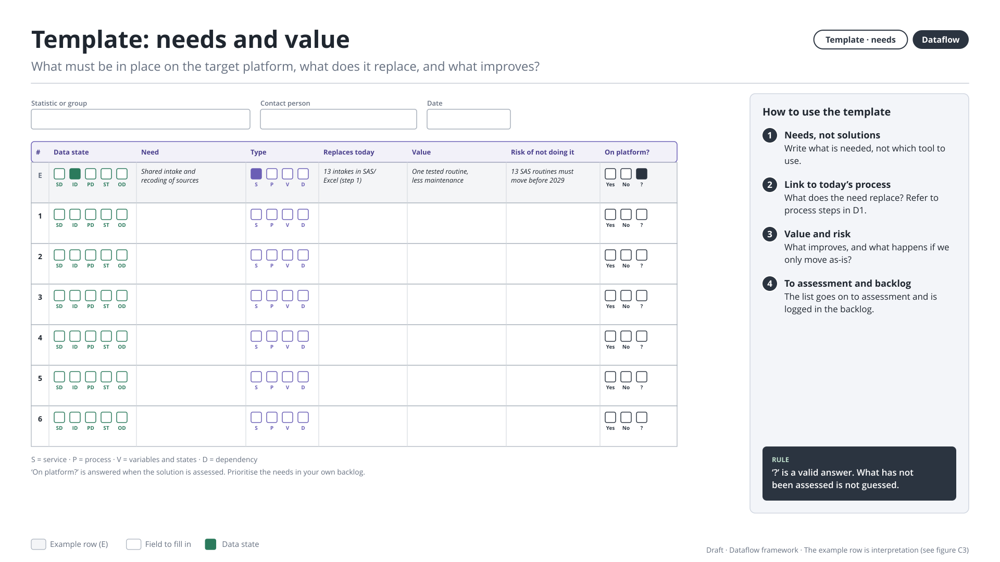

# Template D3: Needs and value

The target state: what must be in place on the target platform, what it replaces, and what improves. The template is based on [figure D3](../5-how-to-map.md#figure-d3).

!!! info "How to fill it in"

    1. **Choose the data state** for each need: source, input, processed, statistics or output data.
    2. **Write the need,** not the solution.
    3. **Link to today’s process:** what does the need replace?
    4. **Value and risk:** what improves, and what happens if we only move as-is?

    Your answers are stored only in this browser. When you are done, select **Make text for the AI assistant** and paste the text into your assistant. You can also download your answers or make a backup from the [overview](index.md#your-answers).

!!! warning "Do not enter information that must not be shared"
    The templates describe systems, data sets and processes, not people or figures. Do not enter personal data, unpublished figures, passwords or access information. The text you make is meant for an AI tool: follow your organisation's guidelines for using AI.

<button type="button" class="md-button md-button--primary" data-do="ai">Make text for the AI assistant</button><button type="button" class="md-button" data-do="copy">Copy answers</button><button type="button" class="md-button" data-do="download">Download (.md)</button><button type="button" class="md-button" data-do="print">Print</button><button type="button" class="md-button tmpl-clear" data-do="clear">Clear template</button>

Text for the AI assistant. Copy it into a conversation, together with a Dataflow 2.0 Excel file if you have one.
<textarea readonly rows="8" aria-label="Text for the AI assistant"></textarea><button type="button" class="md-button" data-do="copyai">Copy the text</button>
<form class="tmpl-form" onsubmit="return false"><datalist id="platforms"><option value="SAS"><option value="FAME"><option value="Oracle"><option value="Excel"><option value="R"><option value="Python"><option value="SQL database"><option value="Survey tool"><option value="Web portal"><option value="Cloud platform"></datalist><datalist id="roles"><option value="statistician"><option value="statistics owner"><option value="methodologist"><option value="IT / developer"><option value="dissemination"><option value="external supplier"></datalist><section class="tmpl-part tmpl-common"><h3>About the statistic (shared by all templates)</h3>
<label class="tmpl-field">Statistic<input type="text" data-k="common.statistic" data-l="Statistic" placeholder="Example: Income and capital accounts"></label><label class="tmpl-field">Short name<input type="text" data-k="common.short" data-l="Short name" placeholder="Example: NR IKR"></label><label class="tmpl-field">Organisational unit<input type="text" data-k="common.unit" data-l="Organisational unit" placeholder="Example: National accounts division"></label><label class="tmpl-field">Contact person<input type="text" data-k="common.contact" data-l="Contact person" placeholder="Role or name"></label>

<label class="tmpl-field">Does the template cover one statistic or a group?<select data-k="common.scope" data-l="Applies to"><option value=""></option><option value="one">One statistic</option><option value="group">A group of statistics</option></select></label><label class="tmpl-field">Statistics in the group<input type="text" data-k="common.group" data-l="Statistics in the group" placeholder="Groups only: short names or initials"></label><label class="tmpl-field">Date<input type="text" data-k="common.date" data-l="Date" placeholder="Example: 26 Nov 2026"></label>
</section><section class="tmpl-part "><h3>Needs per data state</h3>
Write what is needed, not which tool to use. ‘On target platform?’ is answered later, when the solution is assessed.

<table class="tmpl-t"><thead><tr><th>#</th><th>Data state</th><th>Need</th><th>Type</th><th>Replaces today</th><th>Value</th><th>Risk of not doing it</th><th>On target platform?</th></tr></thead><tbody><tr><td class="tmpl-nr">1</td><td style="min-width:9em"><select data-k="D3.need.1.state" data-l="Data state"><option value=""></option><option value="SD">SD · source data</option><option value="ID">ID · input data</option><option value="PD">PD · processed data</option><option value="ST">ST · statistics</option><option value="OD">OD · output data</option><option value="none">none</option><option value="?">?</option></select></td><td style="min-width:14em"><textarea data-k="D3.need.1.need" data-l="Need" rows="1" placeholder="Shared intake and recoding of sources"></textarea></td><td style="min-width:9em"><select data-k="D3.need.1.type" data-l="Type"><option value=""></option><option value="S">S · service</option><option value="P">P · process</option><option value="V">V · variables and states</option><option value="D">D · dependency</option><option value="?">?</option></select></td><td style="min-width:11em"><textarea data-k="D3.need.1.replaces" data-l="Replaces today" rows="1" placeholder="13 intakes in SAS/Excel (step 1)"></textarea></td><td style="min-width:12em"><textarea data-k="D3.need.1.value" data-l="Value" rows="1" placeholder="One tested routine, less maintenance"></textarea></td><td style="min-width:12em"><textarea data-k="D3.need.1.risk" data-l="Risk of not doing it" rows="1" placeholder="13 SAS routines must move before the deadline"></textarea></td><td style="min-width:7em"><select data-k="D3.need.1.exists" data-l="On target platform?"><option value=""></option><option value="yes">Yes</option><option value="no">No</option><option value="?">?</option></select></td></tr><tr><td class="tmpl-nr">2</td><td style="min-width:9em"><select data-k="D3.need.2.state" data-l="Data state"><option value=""></option><option value="SD">SD · source data</option><option value="ID">ID · input data</option><option value="PD">PD · processed data</option><option value="ST">ST · statistics</option><option value="OD">OD · output data</option><option value="none">none</option><option value="?">?</option></select></td><td style="min-width:14em"><textarea data-k="D3.need.2.need" data-l="Need" rows="1"></textarea></td><td style="min-width:9em"><select data-k="D3.need.2.type" data-l="Type"><option value=""></option><option value="S">S · service</option><option value="P">P · process</option><option value="V">V · variables and states</option><option value="D">D · dependency</option><option value="?">?</option></select></td><td style="min-width:11em"><textarea data-k="D3.need.2.replaces" data-l="Replaces today" rows="1"></textarea></td><td style="min-width:12em"><textarea data-k="D3.need.2.value" data-l="Value" rows="1"></textarea></td><td style="min-width:12em"><textarea data-k="D3.need.2.risk" data-l="Risk of not doing it" rows="1"></textarea></td><td style="min-width:7em"><select data-k="D3.need.2.exists" data-l="On target platform?"><option value=""></option><option value="yes">Yes</option><option value="no">No</option><option value="?">?</option></select></td></tr><tr><td class="tmpl-nr">3</td><td style="min-width:9em"><select data-k="D3.need.3.state" data-l="Data state"><option value=""></option><option value="SD">SD · source data</option><option value="ID">ID · input data</option><option value="PD">PD · processed data</option><option value="ST">ST · statistics</option><option value="OD">OD · output data</option><option value="none">none</option><option value="?">?</option></select></td><td style="min-width:14em"><textarea data-k="D3.need.3.need" data-l="Need" rows="1"></textarea></td><td style="min-width:9em"><select data-k="D3.need.3.type" data-l="Type"><option value=""></option><option value="S">S · service</option><option value="P">P · process</option><option value="V">V · variables and states</option><option value="D">D · dependency</option><option value="?">?</option></select></td><td style="min-width:11em"><textarea data-k="D3.need.3.replaces" data-l="Replaces today" rows="1"></textarea></td><td style="min-width:12em"><textarea data-k="D3.need.3.value" data-l="Value" rows="1"></textarea></td><td style="min-width:12em"><textarea data-k="D3.need.3.risk" data-l="Risk of not doing it" rows="1"></textarea></td><td style="min-width:7em"><select data-k="D3.need.3.exists" data-l="On target platform?"><option value=""></option><option value="yes">Yes</option><option value="no">No</option><option value="?">?</option></select></td></tr><tr><td class="tmpl-nr">4</td><td style="min-width:9em"><select data-k="D3.need.4.state" data-l="Data state"><option value=""></option><option value="SD">SD · source data</option><option value="ID">ID · input data</option><option value="PD">PD · processed data</option><option value="ST">ST · statistics</option><option value="OD">OD · output data</option><option value="none">none</option><option value="?">?</option></select></td><td style="min-width:14em"><textarea data-k="D3.need.4.need" data-l="Need" rows="1"></textarea></td><td style="min-width:9em"><select data-k="D3.need.4.type" data-l="Type"><option value=""></option><option value="S">S · service</option><option value="P">P · process</option><option value="V">V · variables and states</option><option value="D">D · dependency</option><option value="?">?</option></select></td><td style="min-width:11em"><textarea data-k="D3.need.4.replaces" data-l="Replaces today" rows="1"></textarea></td><td style="min-width:12em"><textarea data-k="D3.need.4.value" data-l="Value" rows="1"></textarea></td><td style="min-width:12em"><textarea data-k="D3.need.4.risk" data-l="Risk of not doing it" rows="1"></textarea></td><td style="min-width:7em"><select data-k="D3.need.4.exists" data-l="On target platform?"><option value=""></option><option value="yes">Yes</option><option value="no">No</option><option value="?">?</option></select></td></tr><tr><td class="tmpl-nr">5</td><td style="min-width:9em"><select data-k="D3.need.5.state" data-l="Data state"><option value=""></option><option value="SD">SD · source data</option><option value="ID">ID · input data</option><option value="PD">PD · processed data</option><option value="ST">ST · statistics</option><option value="OD">OD · output data</option><option value="none">none</option><option value="?">?</option></select></td><td style="min-width:14em"><textarea data-k="D3.need.5.need" data-l="Need" rows="1"></textarea></td><td style="min-width:9em"><select data-k="D3.need.5.type" data-l="Type"><option value=""></option><option value="S">S · service</option><option value="P">P · process</option><option value="V">V · variables and states</option><option value="D">D · dependency</option><option value="?">?</option></select></td><td style="min-width:11em"><textarea data-k="D3.need.5.replaces" data-l="Replaces today" rows="1"></textarea></td><td style="min-width:12em"><textarea data-k="D3.need.5.value" data-l="Value" rows="1"></textarea></td><td style="min-width:12em"><textarea data-k="D3.need.5.risk" data-l="Risk of not doing it" rows="1"></textarea></td><td style="min-width:7em"><select data-k="D3.need.5.exists" data-l="On target platform?"><option value=""></option><option value="yes">Yes</option><option value="no">No</option><option value="?">?</option></select></td></tr><tr><td class="tmpl-nr">6</td><td style="min-width:9em"><select data-k="D3.need.6.state" data-l="Data state"><option value=""></option><option value="SD">SD · source data</option><option value="ID">ID · input data</option><option value="PD">PD · processed data</option><option value="ST">ST · statistics</option><option value="OD">OD · output data</option><option value="none">none</option><option value="?">?</option></select></td><td style="min-width:14em"><textarea data-k="D3.need.6.need" data-l="Need" rows="1"></textarea></td><td style="min-width:9em"><select data-k="D3.need.6.type" data-l="Type"><option value=""></option><option value="S">S · service</option><option value="P">P · process</option><option value="V">V · variables and states</option><option value="D">D · dependency</option><option value="?">?</option></select></td><td style="min-width:11em"><textarea data-k="D3.need.6.replaces" data-l="Replaces today" rows="1"></textarea></td><td style="min-width:12em"><textarea data-k="D3.need.6.value" data-l="Value" rows="1"></textarea></td><td style="min-width:12em"><textarea data-k="D3.need.6.risk" data-l="Risk of not doing it" rows="1"></textarea></td><td style="min-width:7em"><select data-k="D3.need.6.exists" data-l="On target platform?"><option value=""></option><option value="yes">Yes</option><option value="no">No</option><option value="?">?</option></select></td></tr><tr><td class="tmpl-nr">7</td><td style="min-width:9em"><select data-k="D3.need.7.state" data-l="Data state"><option value=""></option><option value="SD">SD · source data</option><option value="ID">ID · input data</option><option value="PD">PD · processed data</option><option value="ST">ST · statistics</option><option value="OD">OD · output data</option><option value="none">none</option><option value="?">?</option></select></td><td style="min-width:14em"><textarea data-k="D3.need.7.need" data-l="Need" rows="1"></textarea></td><td style="min-width:9em"><select data-k="D3.need.7.type" data-l="Type"><option value=""></option><option value="S">S · service</option><option value="P">P · process</option><option value="V">V · variables and states</option><option value="D">D · dependency</option><option value="?">?</option></select></td><td style="min-width:11em"><textarea data-k="D3.need.7.replaces" data-l="Replaces today" rows="1"></textarea></td><td style="min-width:12em"><textarea data-k="D3.need.7.value" data-l="Value" rows="1"></textarea></td><td style="min-width:12em"><textarea data-k="D3.need.7.risk" data-l="Risk of not doing it" rows="1"></textarea></td><td style="min-width:7em"><select data-k="D3.need.7.exists" data-l="On target platform?"><option value=""></option><option value="yes">Yes</option><option value="no">No</option><option value="?">?</option></select></td></tr><tr><td class="tmpl-nr">8</td><td style="min-width:9em"><select data-k="D3.need.8.state" data-l="Data state"><option value=""></option><option value="SD">SD · source data</option><option value="ID">ID · input data</option><option value="PD">PD · processed data</option><option value="ST">ST · statistics</option><option value="OD">OD · output data</option><option value="none">none</option><option value="?">?</option></select></td><td style="min-width:14em"><textarea data-k="D3.need.8.need" data-l="Need" rows="1"></textarea></td><td style="min-width:9em"><select data-k="D3.need.8.type" data-l="Type"><option value=""></option><option value="S">S · service</option><option value="P">P · process</option><option value="V">V · variables and states</option><option value="D">D · dependency</option><option value="?">?</option></select></td><td style="min-width:11em"><textarea data-k="D3.need.8.replaces" data-l="Replaces today" rows="1"></textarea></td><td style="min-width:12em"><textarea data-k="D3.need.8.value" data-l="Value" rows="1"></textarea></td><td style="min-width:12em"><textarea data-k="D3.need.8.risk" data-l="Risk of not doing it" rows="1"></textarea></td><td style="min-width:7em"><select data-k="D3.need.8.exists" data-l="On target platform?"><option value=""></option><option value="yes">Yes</option><option value="no">No</option><option value="?">?</option></select></td></tr><tr><td class="tmpl-nr">9</td><td style="min-width:9em"><select data-k="D3.need.9.state" data-l="Data state"><option value=""></option><option value="SD">SD · source data</option><option value="ID">ID · input data</option><option value="PD">PD · processed data</option><option value="ST">ST · statistics</option><option value="OD">OD · output data</option><option value="none">none</option><option value="?">?</option></select></td><td style="min-width:14em"><textarea data-k="D3.need.9.need" data-l="Need" rows="1"></textarea></td><td style="min-width:9em"><select data-k="D3.need.9.type" data-l="Type"><option value=""></option><option value="S">S · service</option><option value="P">P · process</option><option value="V">V · variables and states</option><option value="D">D · dependency</option><option value="?">?</option></select></td><td style="min-width:11em"><textarea data-k="D3.need.9.replaces" data-l="Replaces today" rows="1"></textarea></td><td style="min-width:12em"><textarea data-k="D3.need.9.value" data-l="Value" rows="1"></textarea></td><td style="min-width:12em"><textarea data-k="D3.need.9.risk" data-l="Risk of not doing it" rows="1"></textarea></td><td style="min-width:7em"><select data-k="D3.need.9.exists" data-l="On target platform?"><option value=""></option><option value="yes">Yes</option><option value="no">No</option><option value="?">?</option></select></td></tr><tr><td class="tmpl-nr">10</td><td style="min-width:9em"><select data-k="D3.need.10.state" data-l="Data state"><option value=""></option><option value="SD">SD · source data</option><option value="ID">ID · input data</option><option value="PD">PD · processed data</option><option value="ST">ST · statistics</option><option value="OD">OD · output data</option><option value="none">none</option><option value="?">?</option></select></td><td style="min-width:14em"><textarea data-k="D3.need.10.need" data-l="Need" rows="1"></textarea></td><td style="min-width:9em"><select data-k="D3.need.10.type" data-l="Type"><option value=""></option><option value="S">S · service</option><option value="P">P · process</option><option value="V">V · variables and states</option><option value="D">D · dependency</option><option value="?">?</option></select></td><td style="min-width:11em"><textarea data-k="D3.need.10.replaces" data-l="Replaces today" rows="1"></textarea></td><td style="min-width:12em"><textarea data-k="D3.need.10.value" data-l="Value" rows="1"></textarea></td><td style="min-width:12em"><textarea data-k="D3.need.10.risk" data-l="Risk of not doing it" rows="1"></textarea></td><td style="min-width:7em"><select data-k="D3.need.10.exists" data-l="On target platform?"><option value=""></option><option value="yes">Yes</option><option value="no">No</option><option value="?">?</option></select></td></tr></tbody></table>
</section><section class="tmpl-part "><h3>Summary</h3>
<label class="tmpl-field">What is the most important need?<textarea data-k="D3.main" data-l="The most important need" rows="3"></textarea></label><label class="tmpl-field">Where does the migration add most value?<textarea data-k="D3.value" data-l="Most value" rows="3"></textarea></label><label class="tmpl-field">What must be clarified before a solution can be chosen?<textarea data-k="D3.open" data-l="To be clarified" rows="3"></textarea></label>
</section></form>

??? note "The template as a figure (for printing or a whiteboard)"

    { loading=lazy }

    [Download SVG](../figures/D3.svg){ download }

[← Template D2](d2.md) · [All templates](index.md)
